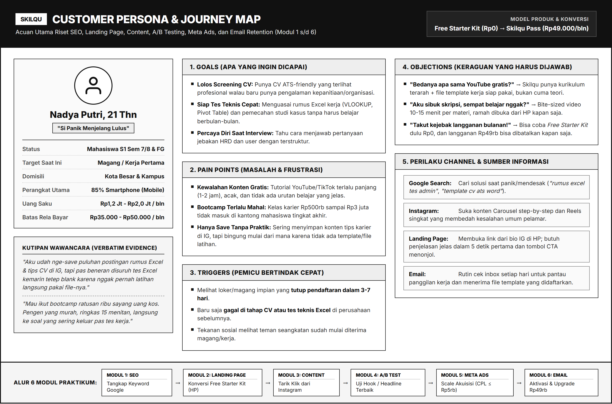

# MODUL 00: BUSINESS CASE, BRAND IDENTITY, & CUSTOMER PERSONA
## Proyek Praktikum Terpadu: **SKILQU**
**Mata Kuliah**: Pemasaran Digital (Digital Marketing)  
**Program Studi**: Inovasi Digital, Departemen Sistem Informasi, FTEIC  
**Institusi**: Institut Teknologi Sepuluh Nopember (ITS)  
**Format Kelas**: 40 Mahasiswa (8 Growth Squad × 5 Orang) | 7 Pertemuan Pasca-UTS (6 Modul Praktikum + 1 Final Growth War Room)

---

## A. Gambaran Umum Proyek Praktikum (Digital Growth Lab)

Dalam praktikum Pemasaran Digital ini, pemasaran digital tidak dipelajari sebagai kumpulan *tools* yang terpisah, melainkan sebagai **satu proses terpadu membangun dan mengoptimalkan akuisisi hingga retensi pelanggan berbasis data (*end-to-end growth funnel*)**.

Seluruh kelompok (*Growth Squad*) berperan sebagai **Tim Growth & Digital Marketing** pada satu perusahaan yang sama, yaitu **Skilqu**. Selama 6 modul berturut-turut, setiap kelompok akan menyelesaikan masalah bisnis Skilqu dari hulu ke hilir:
1. **Modul 1 (SEO Optimization)**: Menangkap permintaan pencarian organik di Google.
2. **Modul 2 (Landing Page & Usability Testing)**: Mengonversi pengunjung menjadi pendaftar *Free Starter Kit* melalui halaman *mobile-first*.
3. **Modul 3 (Content Making)**: Menarik perhatian audiens di Instagram dan mendorong klik ke *landing page*.
4. **Modul 4 (A/B Testing)**: Menguji satu variabel eksperimen secara terkontrol untuk menemukan pesan/visual paling efektif.
5. **Modul 5 (Meta Ads)**: Memperluas jangkauan akuisisi berbayar menggunakan *winning creative* dan mengevaluasi efisiensi biaya (*CPL, CAC, ROAS*).
6. **Modul 6 (Retention & Subscription Email Marketing)**: Mengaktifkan pendaftar gratis dan mendorong konversi ke langganan berbayar menggunakan otomasi email.
7. **Minggu 7 (Final Report A-Z / Growth War Room)**: Mempresentasikan hasil *funnel* utuh, pembelajaran data, dan rekomendasi *Scale / Iterate / Stop*.

---

## B. Profil Perusahaan & Produk: **Skilqu**

### 1. Identitas Dasar Perusahaan
* **Nama Brand**: **Skilqu**
* **Tagline Utama**: *"Skill Praktis Buat Tembus Kerja Pertama"*
* **Kategori Industri**: EdTech / *Bite-Sized Career & Workplace Skills Platform* (B2C Freemium-to-Subscription)
* **Target Pasar Utama**: Mahasiswa tingkat akhir (Semester 6-8) dan *fresh graduate* (0-1 tahun lulus) di Indonesia yang sedang mempersiapkan diri melamar magang (*internship*) atau pekerjaan pertama (*entry-level / management trainee*).

### 2. Deskripsi Produk & Arsitektur Penawaran
**Skilqu** adalah platform belajar karier berbasis web (*mobile-friendly*) yang menyediakan **video praktik mikro berdurasi 10-15 menit per materi**, **file template kerja siap pakai**, dan **simulasi studi kasus tes rekrutmen nyata** berbahasa Indonesia.

Untuk memastikan setiap kelompok di kelas memiliki ruang eksplorasi kreatif tanpa keluar dari koridor bisnis yang sama, setiap kelompok wajib memilih **1 dari 3 Fokus Materi (*Product Track*) Skilqu** berikut sebagai fokus kampanye kelompoknya dari Modul 1 hingga Modul 6:

| Kode Track | Nama Product Track | Fokus Masalah yang Diselesaikan | Lead Magnet (Skilqu Free Starter Kit) |
| :--- | :--- | :--- | :--- |
| **Track A** | **Excel & Olah Data Kerja** | Gagal saat tes teknis Excel admin/data/finance karena hanya hafal teori tapi bingung mengolah tabel kerja nyata. | Video 15 Menit *"3 Rumus Wajib Tes Kerja (VLOOKUP, XLOOKUP, Pivot)"* + File Excel Latihan & Cheat Sheet. |
| **Track B** | **CV ATS & Portofolio Karier** | Lamaran selalu gagal di tahap *screening* awal karena format CV tidak terbaca sistem ATS dan deskripsi pengalaman kepanitiaan kurang menjual. | Video 15 Menit *"Bedah CV Mahasiswa Minim Pengalaman"* + Template CV ATS-Friendly (Word/Docs) & Action Verbs List. |
| **Track C** | **Interview & Case Study Prep** | Gugup dan berbelit-belit saat menjawab pertanyaan HRD/User serta bingung cara membedah *business case* singkat. | Video 15 Menit *"Teknik STAR untuk Menjawab 10 Pertanyaan Jebakan HR"* + Template Cheat Sheet Interview. |

### 3. Model Monetisasi (Freemium-to-Subscription Funnel)
Skilqu menggunakan pendekatan dua tahap (*two-step acquisition*) untuk menekan hambatan psikologis pengguna baru:
1. **Entry Offer (Gratis / Akuisisi Lead)**: **Skilqu Free Starter Kit (Rp0)**  
   Pengunjung *landing page* cukup mengisi **Nama, Email Aktif, dan Pilihan Track** untuk langsung mendapatkan akses 1 modul video (15 menit) + 1 *template* siap pakai. *(Ini adalah titik konversi utama yang diukur secara aktual pada Modul 2, 3, 4, dan 5).*
2. **Core Paid Offer (Langganan Berbayar)**: **Skilqu Pass (Rp49.000 / bulan atau Rp99.000 / 3 bulan)**  
   Membuka akses tak terbatas ke seluruh **30+ modul praktik lintas track**, *template library* lengkap, latihan soal tes teknis perusahaan, dan fitur *cancel anytime* (bisa berhenti berlangganan kapan saja dengan 1 klik). *(Ini adalah titik konversi hilir yang disimulasikan/diuji pada Modul 5 dan Modul 6).*

---

## C. Brand Identity, Positioning, & Tone of Voice

Seluruh aset yang dibuat mahasiswa (mulai dari *meta description* SEO, *copywriting landing page*, konten Instagram, iklan Meta Ads, hingga email retensi) **wajib mematuhi panduan identitas brand Skilqu** berikut:

### 1. Visi, Misi, & Value Proposition
* **Visi**: Menjadi jembatan persiapan karier paling praktis dan terjangkau bagi jutaan mahasiswa Indonesia menuju pekerjaan pertama mereka.
* **Misi**:
  1. Menyederhanakan materi persiapan kerja yang rumit menjadi modul praktik 15 menit yang langsung bisa dicoba.
  2. Menyediakan *template* dan studi kasus dunia kerja nyata dengan harga setara uang jajan mahasiswa.
* **Core Value Proposition**:
  > *"Persiapan kerja praktis 15 menit sehari lengkap dengan template siap pakai, lebih terarah daripada YouTube gratis, 10x lebih hemat daripada bootcamp."*

### 2. Brand Personality & Tone of Voice
Skilqu berbicara layaknya **"Kakak Tingkat / Mentor Karier yang Suportif, Jujur, dan To-the-Point"**:
* **Praktis & Langsung ke Inti (*Action-Oriented*)**: Tidak menggunakan pembukaan bertele-tele. Langsung tunjukkan masalah, solusi konkret, dan langkah praktiknya.
* **Relatable & Empatik (*Bukan Menakut-nakuti Berlebihan*)**: Memahami kepanikan mahasiswa tingkat akhir yang sedang pusing skripsi sambil cari kerja, tanpa merendahkan mereka.
* **Jujur & Transparan (*Anti-Overclaim*)**: Tidak pernah menjanjikan *"Dijamin 100% langsung diterima kerja BUMN/Unicorn dalam 1 malam"*. Janjikan hal yang realistis: *"CV lebih rapi dan lolos bacaan ATS"*, *"Nggak lagi blank saat disuruh VLOOKUP pas tes kerja"*.
* **Bahasa**: Bahasa Indonesia semi-formal/kasual mahasiswa (*"Kamu"*, bukan *"Anda"* atau *"Kalian semua Para Pencari Kerja"*).

### 3. Panduan Do's & Don'ts Copywriting Skilqu

| Konteks | Contoh yang BENAR (Sesuai Tone Skilqu) | Contoh yang SALAH (Hindari!) |
| :--- | :--- | :--- |
| **Headline Landing Page** | *"Tes Excel Besok? Kuasai 3 Rumus Paling Sering Keluar Hanya dalam 15 Menit (+ File Latihan Gratis)."* | *"Platform E-Learning Terbaik dan Terlengkap untuk Meningkatkan Kompetensi Sumber Daya Manusia Era Industri 4.0."* |
| **Hook Konten IG** | *"Udah nge-save puluhan rumus Excel di IG tapi pas tes kerja tetep blank? Ini penyebabnya..."* | *"Halo Sobat Karier! Tahukah Anda bahwa Microsoft Excel sangat penting di dunia kerja?"* |
| **Tombol CTA** | *"Ambil Template & Video Gratisnya"* / *"Coba Modul Gratis Sekarang"* | *"Submit"* / *"Klik di Sini"* / *"Beli Sekarang"* (pada halaman kelas gratis) |
| **Penawaran Langganan (Email)** | *"Buka 30+ modul & semua template kerja cuma Rp49.000/bulan (seharga 2 es kopi). Bisa berhenti langganan kapan aja."* | *"Segera upgrade akun Anda ke paket Premium sebelum akun Anda kami blokir!"* |

### 4. Identitas Visual Singkat (Untuk Canva & Landing Page)
* **Warna Utama (Primary Navy & Royal Blue)**: `#0F172A` (Slate Navy) & `#2563EB` (Skilqu Royal Blue) - melambangkan kepercayaan, profesionalisme, dan fokus.
* **Warna Aksen / Tombol CTA (Action Amber)**: `#F59E0B` (Amber Gold) atau `#10B981` (Emerald Green) - kontras tinggi agar tombol CTA langsung terlihat di layar HP.
* **Warna Latar (Background)**: `#FFFFFF` (Putih bersih) & `#F8FAFC` (Abu-abu terang lembut) agar nyaman dibaca di layar *smartphone*.
* **Tipografi yang Disarankan di Canva**: *Plus Jakarta Sans*, *Inter*, *Poppins*, atau *Montserrat*.

---

## D. Business Problem & Bottleneck Funnel Saat Ini

Skilqu telah beroperasi selama 6 bulan. Produk dan kurikulumnya mendapat ulasan positif dari pengguna yang sudah mencoba, tetapi pertumbuhan bisnis tersendat karena **tiga masalah kritis (*bottlenecks*) di sepanjang *funnel***:

1. **Masalah 1: Top of Funnel (Discoverability & CTR Rendah)**
   * Ribuan mahasiswa mencari kata kunci seputar persiapan kerja di Google setiap minggu, tetapi halaman Skilqu belum memiliki struktur *on-page SEO* yang menargetkan *search intent* tersebut.
   * Di Instagram, konten Skilqu rata-rata hanya menghasilkan **CTR (Clicks ÷ Impressions) sebesar 2,0%**. Audiens banyak yang menekan tombol *Like* atau *Save*, tetapi tidak mengklik tautan menuju *landing page* karena *hook* kurang tajam dan *CTA* tidak memberikan alasan mendesak untuk berkunjung.
2. **Masalah 2: Middle of Funnel (Konversi Landing Page Mobile Rendah)**
   * Dari **2.000 kunjungan *landing page* per bulan**, hanya **100 pengunjung (5,0%)** yang mendaftar **Skilqu Free Starter Kit**.
   * Sebanyak **95% pengunjung keluar tanpa mendaftar (*bounce*)** karena: (a) tampilan halaman belum *mobile-first* padahal 85% trafik berasal dari HP, (b) pengunjung tidak langsung paham apa yang didapat secara gratis dalam 5 detik pertama, dan (c) tidak ada elemen bukti kepercayaan (*trust element* / pratinjau isi materi).
3. **Masalah 3: Bottom of Funnel (Aktivasi & Konversi Langganan Rendah)**
   * Dari **100 pendaftar gratis per bulan**, hanya **30 orang (30%)** yang benar-benar membuka dan mempelajari modul gratisnya, dan hanya **10 orang (10% dari pendaftar gratis)** yang berlangganan **Skilqu Pass (Rp49.000/bulan)**.
   * Penyebab utamanya adalah **ketiadaan alur komunikasi pasca-pendaftaran (*email onboarding & nurturing*)**. Setelah mengisi formulir, pendaftar tidak menerima email panduan belajar maupun pengingat, sehingga mereka lupa dan akunnya tidak aktif (*dormant*).

---

## E. Baseline Funnel, Target Goals, & Aturan Eksperimen Kelas

### 1. Tabel Baseline vs Target Eksperimen Growth Squad
Seluruh kelompok menggunakan angka *baseline* bulanan Skilqu berikut sebagai titik tolak analisis dan pembanding keberhasilan eksperimen:

| Tahap Funnel | Metrik & Denominator | Baseline Saat Ini (Per Bulan) | Rasio Konversi Baseline | Target Eksperimen Kelas | Modul Utama |
| :--- | :--- | :--- | :--- | :--- | :--- |
| **1. Awareness / Reach** | Total *Impressions* | `100.000` impressions | - | Menemukan keyword prioritas & *content angle* yang relevan | Modul 1 & 3 |
| **2. Traffic / Clicks** | *Landing Page Visitors* dari *Impressions* | `2.000` visitors dari `100.000` impressions | **CTR = 2,0%** | **Target Outbound CTR $\ge$ 3,0%** | Modul 3, 4, 5 |
| **3. Lead Acquisition** | Pendaftar *Free Starter Kit* dari *Visitors* | `100` pendaftar dari `2.000` visitors | **LP Conversion = 5,0%** | **Target LP Conversion $\ge$ 8,0%** & **Usability Task Completion $\ge$ 80%** | Modul 2, 4, 5 |
| **4. Activation** | User yang mulai belajar dari total Pendaftar | `30` user aktif dari `100` pendaftar | **Activation Rate = 30,0%** | **Target Email Click Rate $\ge$ 15,0%** pada email *onboarding* | Modul 6 |
| **5. Paid Subscription** | Pelanggan *Skilqu Pass* (Rp49rb) dari Pendaftar | `10` pelanggan dari `100` pendaftar gratis | **Free-to-Paid Conv. = 10,0%** (`0,5%` dari total visitors) | **Target Paid Conv. $\ge$ 15,0%** pada simulasi penawaran email | Modul 5 & 6 |
| **6. Retention (Bulan ke-2)** | Pelanggan bertahan di bulan ke-2 | `3` pelanggan dari `10` pelanggan bulan ke-1 | **Month-2 Retention = 30,0%** | Merancang alur retensi untuk menekan *churn* | Modul 6 & 7 |

### 2. Guardrails Finansial (Batas Biaya & Unit Economics)
* **Harga Jual Langganan (*Skilqu Pass*)**: **Rp49.000 / bulan** (atau Rp99.000 / 3 bulan).
* **Batas Atas Biaya per Pendaftar Gratis (*Target Maximum CPL / Cost per Registration*)**: **Rp5.000 per pendaftar gratis**.
* **Batas Atas Biaya Akuisisi Pelanggan Berbayar (*CAC Ceiling*)**: **Rp50.000 per pelanggan berbayar baru**.  
  *(Logika perhitungan: Jika CPL = Rp5.000 dan rasio konversi dari pendaftar gratis ke pelanggan berbayar adalah 10%, maka $\text{Simulated CAC} = \text{Rp5.000} \div 10\% = \text{Rp50.000}$. Jika kelompok berhasil menekan CPL di bawah Rp5.000 atau menaikkan rasio konversi di atas 10%, maka CAC akan semakin sehat di bawah Rp49.000).*
* **Pemisahan Biaya Aktual vs Simulasi**:
  * **Actual Spend**: Uang riil yang dibelanjakan pada kampanye Meta Ads (sesuai budget yang diberikan dosen).
  * **Simulated Spend / Projection**: Perhitungan proyeksi biaya jika eksperimen di-*scale* untuk mencapai target 100 pelanggan berbayar baru.
  * **Aturan Kanal Organik**: Jangan pernah menyamakan `Organic CAC = Rp0` dengan bukti bahwa kanal organik pasti paling mudah di-*scale* tanpa batas waktu dan tenaga.

### 3. Definisi Baku Variabel & Metrik (Wajib Dipakai di Semua Laporan)
Agar laporan 8 kelompok dapat dibandingkan secara adil (*apples-to-apples*), gunakan lima definisi berikut di setiap modul:
1. **Variabel Eksperimen**: Satu unsur spesifik yang sengaja diubah untuk diuji (contoh: *Hook A vs Hook B*, atau *Headline A vs Headline B*).
2. **KPI Utama (*Primary KPI*)**: Satu metrik utama yang menjadi penentu keberhasilan modul/eksperimen tersebut (contoh: *Landing Conversion Rate*).
3. **Metrik Pendukung (*Secondary/Diagnostic Metrics*)**: Metrik tambahan untuk membantu mendiagnosis mengapa KPI utama naik atau turun (contoh: *Reach, Saves, Shares, Time on Task, Email Open Rate*).
4. **Kondisi Kontrol (*Control Variables*)**: Faktor yang wajib dijaga tetap sama agar pengujian adil (contoh: platform yang sama, target audiens yang sama, durasi pengamatan yang sama).
5. **Unit & Denominator Wajib**: Setiap penyebutan persentase **wajib menyertakan angka pembilang dan penyebutnya**.  
   * *Contoh Benar*: *"Konversi halaman meningkat menjadi 8,0% (16 pendaftar dari 200 landing visitors)."*  
   * *Contoh Salah*: *"Konversi halaman kami naik jadi 8%."*

---

## F. Customer Persona Perusahaan

Seluruh kelompok menggunakan profil **Customer Persona** berikut sebagai acuan riset dan eksekusi:

### Detail Profil Persona: **Nadya Putri (21 Tahun) ("Si Panik Menjelang Lulus")**

| Komponen Persona | Penjelasan Lengkap |
| :--- | :--- |
| **Demografi & Akademik** | Mahasiswa S1 Semester 7/8 atau *fresh graduate* baru lulus (< 6 bulan) di kota besar/penyangga (Surabaya, Jabodetabek, Bandung, Malang, Yogyakarta). Sedang menyusun skripsi sambil aktif melamar magang (*internship*) atau kerja pertama. |
| **Perilaku Perangkat** | **85% Mobile-First**. Membuka Instagram, mencari artikel di Google, mengecek email, hingga mencoba halaman web hampir semuanya dilakukan dari layar *smartphone* (HP). |
| **Kapasitas Finansial** | Uang saku Rp1.200.000 - Rp2.000.000/bulan. Sangat berhati-hati mengeluarkan uang untuk kursus mahal, tetapi **rela membayar Rp35.000 - Rp50.000** (setara 2 gelas es kopi) jika produknya terbukti praktis dan langsung membantu persiapan tes kerja. |
| **Goals (Tujuan Utama)** | 1. Membuat CV yang lolos mesin *screening* ATS meski hanya punya pengalaman organisasi/kepanitiaan. 2. Menguasai rumus Excel kerja (*VLOOKUP, XLOOKUP, Pivot Table*) dengan cepat sebelum hari tes teknis. 3. Menjawab pertanyaan *interview* HR/User dan studi kasus dengan terstruktur. |
| **Pain Points (Masalah)** | 1. **Kewalahan konten gratis**: Video YouTube/TikTok terlalu panjang (1-2 jam), acak, dan tidak ada urutan belajar yang jelas. 2. **Harga bootcamp tidak terjangkau**: Kelas persiapan karier umumnya Rp500.000 - Rp3.000.000 dan memakan waktu berbulan-bulan. 3. **Fenomena "Save tapi Nggak Praktik"**: Punya puluhan *saved posts* tips karier di Instagram, tetapi tetap *blank* saat tes kerja karena tidak pernah berlatih menggunakan file/template nyata. |
| **Triggers (Pemicu)** | • Melihat pembukaan lowongan kerja/magang impian yang tutup pendaftaran dalam 3-7 hari. • Baru saja menerima email penolakan di tahap CV atau gagal mengerjakan soal tes Excel. • Melihat teman satu angkatan mulai mengunggah kabar diterima magang/kerja di LinkedIn/IG. |
| **Objections (Keraguan)** | • *"Apa bedanya Skilqu sama nonton tutorial gratis di YouTube atau TikTok?"* • *"Aku lagi dikejar revisi skripsi, bakal sempat nggak ya nonton materinya?"* • *"Kalau daftar atau langganan bulanan, nanti ribet nggak cara berhentinya?"* |
| **Sumber Informasi & Channel** | • **Google Search**: Digunakan saat butuh solusi spesifik & mendesak (*high intent*). • **Instagram**: Digunakan saat *scrolling* harian; tertarik pada *carousel* bedah kasus & *Reels* singkat. • **Email**: Dibuka setiap hari untuk memantau balasan lamaran kerja dan mengunduh file/template. |

### Kutipan Wawancara Pelanggan (*Verbatim Evidence*)
1. *"Aku tuh udah nge-save puluhan postingan rumus Excel dan tips CV di IG, tapi pas beneran disuruh tes Excel kemarin tetep blank karena nggak pernah nyoba langsung pakai file latihannya."* - **Nadya, 21 thn (Mahasiswa Sem 8)**
2. *"Mau ikut bootcamp harganya ratusan ribu, sayang uang kos. Pengennya yang murah aja, langsung ke poin yang sering keluar pas tes kerja, nggak usah teori panjang-panjang."* - **Raka, 22 thn (Fresh Graduate)**
3. *"Kemarin sempat buka web kursus online dari link bio IG di HP, tapi tulisannya kecil-kecil dan disuruh langsung bayar di depan sebelum tahu isi videonya kayak gimana. Akhirnya langsung aku tutup."* - **Nadya, 21 thn (Mahasiswa Sem 8)**

---

## G. Tugas Kickoff Minggu 1: Growth Brief & Diagnosis Buyer Journey

Sebelum masuk ke teknis **Modul 1 (SEO Optimization)**, setiap kelompok wajib menyusun **Growth Brief & Buyer Journey Diagnosis (2 Halaman)** sebagai fondasi kerja kelompok:

1. **Identitas Kelompok & Pilihan Track**:
   * Nama Growth Squad, daftar 5 anggota beserta pembagian peran awal (*Project/Data Lead, SEO & Copy Specialist, UI/Landing Page Specialist, Content & Creative Specialist, Ads & Automation Specialist*).
   * Pilihan **1 Product Track Skilqu** (Track A: Excel Kerja / Track B: CV ATS / Track C: Interview & Case Study) beserta alasan memilih track tersebut.
2. **Diagnosis Buyer Journey Persona Nadya**:
   * Petakan kondisi Nadya ke dalam 4 tahap: **Awareness $\rightarrow$ Consideration $\rightarrow$ Decision $\rightarrow$ Retention/Subscription**.
   * Tentukan **1 tahap yang menurut kelompok paling kritis (*most critical bottleneck*)** berdasarkan kutipan *verbatim* dan angka *baseline funnel* Skilqu, lalu sertakan implikasi pemasarannya.
3. **Rumusan Target Operasional Kelompok**:
   * Tuliskan target konversi kelompok dari *Impressions* hingga *Paid Subscription* lengkap dengan **angka pembilang dan denominatornya** (tidak boleh hanya menulis persentase tanpa basis angka).
