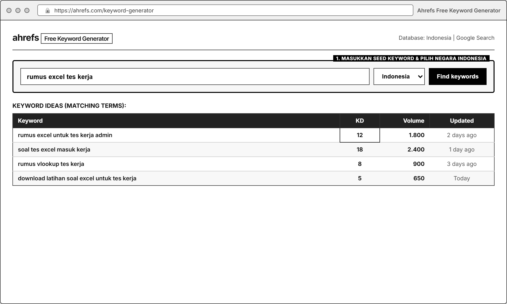
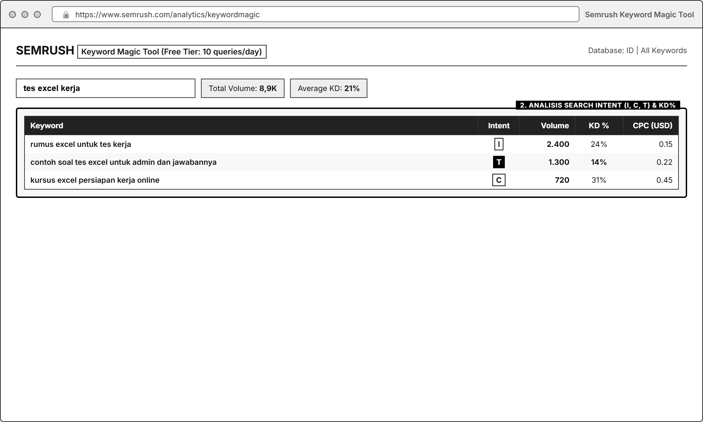
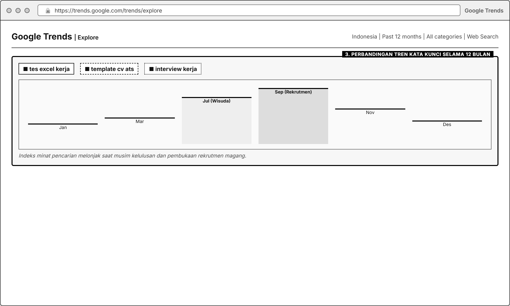
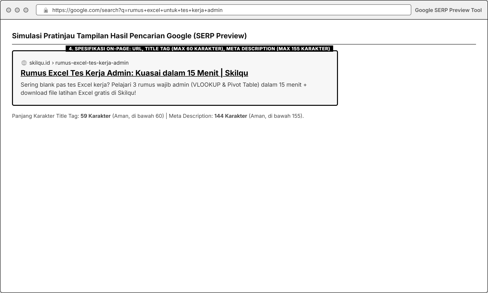

# MODUL 01: SEARCH ENGINE OPTIMIZATION (SEO) & KEYWORD RESEARCH
**Mata Kuliah**: Pemasaran Digital (Digital Marketing)  
**Program Studi**: Inovasi Digital, Departemen Sistem Informasi, FTEIC  
**Institusi**: Institut Teknologi Sepuluh Nopember (ITS)  
**Minggu Pelaksanaan**: Minggu ke-1 (Laporan & Presentasi Progres di Minggu ke-2)  
**Tools Praktikum**: Ahrefs Free Keyword Generator, Semrush (Free Tier), Google Trends, Google Sheets / Docs

---

## 1. Pengantar & Tujuan Praktikum

### A. Apa itu SEO dalam Akuisisi Pelanggan?
**Search Engine Optimization (SEO)** adalah proses mengoptimalkan halaman web agar mudah ditemukan di mesin pencari (seperti Google) ketika calon pelanggan mencari kata kunci (*keyword*) yang berkaitan dengan masalah, kebutuhan, atau produk kita.

Berbeda dengan media sosial di mana konten "mendatangi" pengguna yang sedang bersantai, trafik pencarian organik (*organic search*) memiliki kualitas tinggi karena **pengguna datang dengan niat aktif (*search intent*) untuk menyelesaikan suatu masalah**.

### B. Kaitan Modul 1 dengan Business Case **Skilqu**
Pada studi kasus **Skilqu**, persona kita (**Nadya Putri (21 tahun, mahasiswa tingkat akhir)**) aktif menggunakan Google Search ketika sedang panik menghadapi jadwal seleksi kerja atau magang (contoh: mencari *"rumus excel tes kerja admin"*, *"cara membuat cv ats mahasiswa tanpa pengalaman"*, atau *"pertanyaan interview magang dan jawabannya"*).

Sayangnya, halaman Skilqu saat ini belum muncul di hasil pencarian karena belum memiliki riset kata kunci dan struktur *On-Page SEO* yang tepat. Oleh karena itu, tujuan Modul 1 adalah:
1. Menemukan kata kunci yang benar-benar dicari oleh persona Nadya sesuai **Product Track Skilqu** yang dipilih kelompok (*Track A: Excel Kerja / Track B: CV ATS / Track C: Interview*).
2. Mengevaluasi dan memilih **Top 3-5 Keyword Prioritas** menggunakan matriks keputusan berbasis data (bukan sekadar memilih volume terbesar).
3. Menyusun **On-Page SEO Blueprint** (URL, Title Tag, Meta Description, Heading H1-H3, dan struktur konten) yang pada **Minggu ke-2 (Modul 2)** akan langsung diwujudkan menjadi **Landing Page Skilqu**.

---

## 2. Landasan Teori Singkat: Search Intent & Metrik SEO

### A. Empat Jenis Search Intent
Setiap kata kunci yang diketik pengguna di Google memiliki tujuan (*intent*) di baliknya. Memahami *intent* sangat krusial agar halaman yang kita buat sesuai dengan harapan pencari:

| Jenis Search Intent | Tujuan Pencari | Contoh Keyword (Kasus Skilqu) | Potensi Konversi ke *Free Starter Kit* |
| :--- | :--- | :--- | :--- |
| **1. Informational** | Mencari jawaban, cara, atau tutorial dasar. | *"cara menggunakan rumus vlookup beda sheet"*, *"apa itu cv ats"* | **Sedang - Tinggi** (Jika di dalam artikel langsung disediakan *template* latihan gratis). |
| **2. Commercial Investigation** | Membandingkan pilihan solusi, kursus, atau *template* terbaik. | *"rekomendasi kursus excel online murah"*, *"contoh cv ats fresh graduate terbaik"* | **Tinggi** (Pengguna sudah siap memilih solusi). |
| **3. Transactional** | Siap mengunduh, mendaftar, atau membeli saat itu juga. | *"download template cv ats word gratis"*, *"latihan soal tes excel kerja pdf"* | **Sangat Tinggi** (Sangat dekat dengan aksi pendaftaran *Free Starter Kit*). |
| **4. Navigational** | Mencari nama brand atau situs tertentu yang sudah dikenal. | *"login skilqu"*, *"skilqu career pass"* | **Rendah untuk akuisisi user baru** (Hanya untuk user yang sudah kenal brand). |

### B. Metrik Dasar Riset Keyword
1. **Search Volume**: Rata-rata jumlah pencarian kata kunci per bulan di negara target (Indonesia). *Ingat: Volume besar sering kali terlalu umum dan persaingannya berat.*
2. **Keyword Difficulty (KD)**: Skor tingkat kesulitan (skala 0-100 di Ahrefs/Semrush) untuk menembus halaman pertama Google. Untuk website baru seperti Skilqu, **prioritaskan KD Rendah-Sedang ($\le 30$)** atau *long-tail keyword* (kata kunci spesifik 3-5 kata).
3. **Relevance**: Seberapa erat hubungan kata kunci tersebut dengan masalah persona Nadya dan produk **Skilqu Free Starter Kit**.

---

## 3. Spesifikasi Variabel, KPI Utama, & Rumus Penilaian Modul 1

Agar hasil riset seluruh kelompok dapat diukur secara objektif, berikut adalah variabel dan KPI yang dikunci pada Modul 1:

| Komponen | Spesifikasi yang Dikunci |
| :--- | :--- |
| **Variabel yang Diamati / Diubah** | • Kandidat *Keyword* (*Short-tail* vs *Long-tail*) • *Search Intent* (*Informational, Commercial, Transactional*) • *Search Volume* & *Keyword Difficulty (KD)* • Elemen *On-Page*: *Title Tag*, *Meta Description*, *URL Slug*, *Heading Hierarchy (H1, H2, H3)*, dan *Internal Link* |
| **Kondisi Kontrol** | • Target lokasi riset: **Indonesia (ID)**, Bahasa: **Bahasa Indonesia** • Target Persona: **Nadya Putri (21 thn)** • Produk yang ditawarkan: **Skilqu Free Starter Kit (Rp0)** menuju **Skilqu Pass (Rp49.000/bln)** |
| **KPI Utama 1: Keyword Priority Score** | Dihitung untuk setiap kandidat keyword pada skala **1,00 - 5,00** dengan rumus terbobot: $$\text{Priority Score} = (0{,}30 \times \text{Relevance}) + (0{,}25 \times \text{Intent Fit}) + (0{,}25 \times \text{Acquisition Potential}) + (0{,}20 \times \text{Data Justification})$$ |
| **KPI Utama 2: On-Page SEO Checklist Score** | Persentase kelengkapan spesifikasi *On-Page SEO* pada blueprint halaman ($\text{Item Terpenuhi} \div 10 \text{ Item Standar} \times 100\%$). Target minimal: **90% (9 dari 10 item terpenuhi)**. |
| **Metrik Pendukung** | • *Monthly Search Volume* (Ahrefs/Semrush) • *Keyword Difficulty (KD)* • Indeks Stabilitas/Tren Musiman 12 bulan terakhir (Google Trends) |

> **Catatan Penting Penilaian**: Pada Modul 1, kelompok **tidak dinilai dari apakah halaman berhasil ranking #1 di Google minggu depan** (karena proses *indexing* organik membutuhkan waktu berminggu-minggu), melainkan dinilai dari **ketajaman logika pemilihan keyword dan ketepatan struktur On-Page SEO**.

### Rubrik Skoring Matriks Keputusan Keyword (Skala 1-5 per Kriteria)

| Kriteria | Bobot | Skor 1 (Kurang) | Skor 3 (Cukup) | Skor 5 (Sangat Kuat) |
| :--- | :--- | :--- | :--- | :--- |
| **1. Relevance** | **30%** | Terlalu umum / tidak nyambung dengan produk Skilqu (misal: *"lowongan kerja bumn"*). | Masih berkaitan dengan dunia kerja, tetapi belum spesifik ke modul Skilqu. | Sangat spesifik dengan masalah Nadya & modul Skilqu (misal: *"rumus excel untuk tes kerja admin"*). |
| **2. Search Intent** | **25%** | *Navigational* ke kompetitor lain atau murni definisi sekolah. | *Informational* umum yang masih butuh edukasi panjang. | *Transactional* atau *High-Intent Informational/Commercial* (butuh template/latihan segera). |
| **3. Acquisition Potential** | **25%** | Pencari tidak punya alasan untuk mendaftar *Free Starter Kit*. | Pencari mungkin tertarik daftar jika diberi tambahan tips. | Pencari sangat butuh file template/video 15 menit yang ditawarkan di *Free Starter Kit*. |
| **4. Justification (Bukti Data)** | **20%** | Asumsi pribadi tanpa data volume, KD, atau tren. | Ada data volume/KD tetapi alasan pemilihannya dangkal. | Didukung data Volume, KD yang realistis, Google Trends, dan analisis kenapa menang dari halaman lain. |

---

## 4. Persiapan & Strategi Akses Tools Gratis

> **Batasan Penting Praktikum**:
> Dalam praktikum ini, mahasiswa **TIDAK PERLU** membuat *Project*, tidak perlu memasukkan domain website, tidak perlu verifikasi DNS atau Google Search Console, dan **TIDAK ADA** materi *Technical SEO* (robots.txt, sitemap XML, audit server) maupun *Off-Page SEO* (mencari backlink).
> Praktikum ini murni berfokus pada dua hal:
> 1. **Keyword Research (Riset Kata Kunci)**: Mencari kata kunci dengan intent pencarian yang tepat menggunakan dashboard publik.
> 2. **On-Page SEO Blueprint**: Merancang judul (Title Tag, H1), meta description, dan struktur materi halaman yang minggu depan langsung dipasang di Canva (Modul 2).

Dalam praktikum ini, seluruh tools digunakan menggunakan **akses gratis (Free Tier)** dengan strategi berikut:

1. **Ahrefs Free Keyword Generator**
   * Akses melalui browser: [https://ahrefs.com/keyword-generator](https://ahrefs.com/keyword-generator)
   * **Keunggulan**: Gratis tanpa perlu login kartu kredit, menampilkan hingga 100 ide kata kunci beserta *Search Volume* dan *Keyword Difficulty (KD)* untuk sebagian daftar teratas di Indonesia.
2. **Semrush (Akun Gratis)**
   * Akses melalui browser: [https://www.semrush.com/](https://www.semrush.com/) lalu daftar akun gratis menggunakan email mahasiswa/pribadi.
   * **Batas Akun Gratis & Cara Menyiasatinya**: Akun gratis Semrush membatasi **10 pencarian (*queries*) per hari** di *Keyword Magic Tool* / *Keyword Overview*. Karena 1 kelompok terdiri dari **5 mahasiswa**, setiap anggota dapat membuat 1 akun gratis sehingga kelompok memiliki total kuota **50 pencarian keyword per hari**, sangat cukup untuk meriset 15-20 kata kunci!
3. **Google Trends**
   * Akses melalui browser: [https://trends.google.com/](https://trends.google.com/)
   * **Keunggulan**: 100% gratis tanpa batas untuk melihat perbandingan popularitas kata kunci di Indonesia selama 12 bulan terakhir.

---

## 5. Langkah Praktikum Step-by-Step

### Langkah 1: Brainstorming *Seed Keywords* Berdasarkan Persona & Track
1. Diskusikan bersama kelompok: berdasarkan **Product Track Skilqu** yang kalian pilih (Excel / CV ATS / Interview), kalimat apa yang akan diketik **Nadya** di Google saat dia sedang panik?
2. Buat daftar awal minimal **5 Seed Keywords** (kata kunci induk 2-3 kata).  
   * *Contoh Track A (Excel)*: `tes excel kerja`, `rumus excel admin`, `latihan excel vlookup`, `belajar excel cepat`, `soal excel interview`.
   * *Contoh Track B (CV ATS)*: `template cv ats`, `cv mahasiswa magang`, `contoh cv fresh graduate`, `cara buat cv ats`, `review cv gratis`.
   * *Contoh Track C (Interview)*: `pertanyaan interview magang`, `cara menjawab interview hr`, `studi kasus interview kerja`, `tips lolos interview user`, `latihan interview kerja`.

### Langkah 2: Riset Volume & Difficulty di Ahrefs Free Keyword Generator
1. Buka [https://ahrefs.com/keyword-generator](https://ahrefs.com/keyword-generator).
2. Pastikan tab yang dipilih adalah **Google**, ketik salah satu *Seed Keyword* kelompokmu, ubah negara dari *United States* menjadi **Indonesia**, lalu klik **Find keywords**.
3. Amati dua tab yang muncul:
   * **Phrase match**: Daftar kata kunci turunan yang mengandung kata kunci indukmu.
   * **Questions**: Daftar kata kunci berbentuk pertanyaan (sangat bagus untuk ide konten & sub-heading H2!).
4. Catat kata kunci yang relevan beserta angka **KD (Keyword Difficulty)** dan **Volume**-nya ke dalam Google Sheets kelompokmu, serta ambil *screenshot* hasilnya sebagai bukti laporan.

### Langkah 3: Memperdalam Intent & Variasi di Semrush Keyword Magic Tool
1. Login ke akun gratis [Semrush](https://www.semrush.com/), lalu pilih menu **SEO** $\rightarrow$ **Keyword Magic Tool** di bilah kiri.
2. Masukkan *Seed Keyword* terbaikmu, pilih database **Indonesia (ID)**, lalu klik **Search**.
3. Perhatikan kolom-kolom penting yang ditampilkan Semrush:
   * **Intent**: `I` (*Informational*), `C` (*Commercial*), `T` (*Transactional*), `N` (*Navigational*).
   * **Volume**: Rata-rata pencarian bulanan.
   * **KD %**: Persentase kesulitan kata kunci.
4. Gunakan filter atau amati *long-tail keywords* (kata kunci dengan 3 kata atau lebih) yang memiliki *Intent* selaras dengan pendaftaran *Skilqu Free Starter Kit*.
5. Kumpulkan total minimal **15 kandidat keyword** (gabungan temuan Ahrefs dan Semrush) ke dalam tabel kerja kelompok.

### Langkah 4: Validasi Tren Musiman di Google Trends
1. Buka [https://trends.google.com/trends/](https://trends.google.com/trends/) dan pilih menu **Explore (Pelajari)**.
2. Masukkan hingga 3-5 kata kunci utama kelompokmu untuk dibandingkan sekaligus.
3. Atur filter di bagian atas:
   * Lokasi: **Indonesia**
   * Rentang Waktu: **Past 12 months (12 bulan terakhir)**
   * Kategori: **All categories** | Tipe Pencarian: **Web Search**
4. Analisis grafik trennya: Apakah kata kunci tersebut dicari secara stabil sepanjang tahun, atau melonjak pada bulan-bulan tertentu (misalnya musim kelulusan/rekrutmen magang)? Ambil *screenshot* grafik perbandingan tersebut.

### Langkah 5: Menyusun *SEO Decision Matrix* & Memilih Top 3-5 Prioritas
1. Masukkan **15 kandidat keyword** yang sudah dikumpulkan ke dalam tabel **SEO Decision Matrix** di Google Sheets.
2. Berikan skor **1 sampai 5** untuk setiap keyword pada 4 kriteria: **Relevance (30%)**, **Search Intent (25%)**, **Acquisition Potential (25%)**, dan **Justification (20%)**.
3. Hitung **Priority Score** menggunakan rumus terbobot, lalu urutkan dari skor tertinggi.
4. Tetapkan **Top 3-5 Keyword Prioritas** (1 *Primary Keyword* utama + 2-4 *Secondary/Supporting Keywords*) yang akan dipakai untuk membangun halaman Skilqu.

### Langkah 6: Merancang *On-Page SEO Blueprint* untuk Halaman Skilqu
Gunakan **1 Primary Keyword** dan **Secondary Keywords** terpilih untuk menyusun rancangan halaman (*On-Page SEO Spec*) yang memenuhi **10 Checklist Standar On-Page SEO** berikut:

| No | Elemen On-Page SEO | Aturan & Standar Optimasi | Contoh Implementasi (Track A: Excel Kerja) |
| :--- | :--- | :--- | :--- |
| 1 | **Primary Keyword** | 1 kata kunci utama dengan *Priority Score* tertinggi. | `rumus excel untuk tes kerja admin` |
| 2 | **Secondary Keywords** | 2-3 kata kunci pendukung yang masih satu topik/intent. | `latihan soal excel kerja gratis`, `rumus vlookup tes kerja`, `template latihan excel admin` |
| 3 | **URL Slug** | Pendek, huruf kecil semua, dipisahkan tanda hubung (`-`), mengandung *Primary Keyword*. | `skilqu.id/rumus-excel-tes-kerja-admin` |
| 4 | **SEO Title Tag** | Maksimal **55-60 karakter**, memuat *Primary Keyword* di bagian depan + manfaat utama/angka. | `Rumus Excel Tes Kerja Admin: Kuasai dalam 15 Menit | Skilqu` *(59 karakter)* |
| 5 | **Meta Description** | Maksimal **140-155 karakter**, memuat *Primary/Secondary Keyword*, mengatasi *pain point* Nadya, dan diakhiri *Call-to-Action*. | `Sering blank pas tes Excel kerja? Pelajari 3 rumus wajib admin (VLOOKUP & Pivot) dalam 15 menit + download file latihan Excel gratis di Skilqu!` *(144 karakter)* |
| 6 | **Heading 1 (H1)** | Hanya boleh ada **1 H1** di halaman, memuat *Primary Keyword* dan *Value Proposition* yang jelas bagi pengunjung. | `Kuasai Rumus Excel yang Paling Sering Keluar Saat Tes Kerja Admin (+ File Latihan Gratis)` |
| 7 | **Struktur Sub-Heading (H2 & H3)** | Minimal **3 tag H2** yang menjawab pertanyaan pencari (*Search Intent*) dan memuat *Secondary Keywords*. | • **H2**: 3 Rumus Excel Wajib untuk Tes Admin & Staff Data • **H2**: Kenapa Nonton Tutorial Saja Tidak Cukup Tanpa File Latihan? • **H2**: Download Skilqu Free Starter Kit (Video 15 Menit + Template Excel) |
| 8 | **Opening Paragraph (100 Kata Pertama)** | Menyebutkan *Primary Keyword* secara natural di paragraf pembuka tanpa terlihat dipaksakan (*keyword stuffing*). | Paragraf pembuka yang langsung menyentuh kepanikan Nadya menjelang jadwal tes teknis kerja. |
| 9 | **Image File Name & Alt Text** | Nama file gambar dan *Alt Text* mendeskripsikan isi visual sekaligus memuat keyword relevan. | File: `preview-template-latihan-rumus-excel-admin.png` Alt: `Contoh file latihan rumus Excel VLOOKUP untuk tes kerja admin di Skilqu` |
| 10 | **Internal & Conversion Link** | Arah tautan ke halaman/bagian formulir pendaftaran *Skilqu Free Starter Kit* dan tautan ke info *Skilqu Pass*. | Anchor text jelas menuju section form pendaftaran kelas gratis & halaman paket langganan. |

---

## 6. Tugas Kelompok Minggu 1

1. **Selesaikan Tugas Kickoff (Bagian G pada Modul 00)**:
   * Pembagian peran 5 anggota kelompok, pemilihan **1 Product Track Skilqu**, diagnosis *Buyer Journey* persona Nadya, dan penetapan target *funnel* ber-denominator.
2. **Riset & Tabel SEO Decision Matrix (Minimal 15 Kandidat Keyword)**:
   * Lakukan riset menggunakan **Ahrefs Free**, **Semrush Free**, dan **Google Trends** untuk *Product Track* yang dipilih.
   * Masukkan 15 kandidat keyword ke dalam tabel matriks lengkap dengan data *Search Volume*, *KD*, *Intent*, skor per kriteria, dan perhitungan **Priority Score**.
   * Pilih **Top 3-5 Keyword Prioritas** dan tuliskan analisis singkat (1-2 paragraf) mengapa kelompok memilih keyword tersebut dibanding kandidat lainnya.
3. **Susun On-Page SEO Blueprint & Pratinjau SERP**:
   * Buat spesifikasi lengkap **10 Elemen On-Page SEO** (sesuai tabel pada Langkah 6) untuk halaman *Skilqu Free Starter Kit* yang akan kalian bangun di Modul 2 minggu depan.
   * Buat simulasi tampilan hasil pencarian Google (*Google SERP Snippet Preview*: tampilan URL, Title Tag biru, dan Meta Description).

   * Hitung skor mandiri **On-Page SEO Checklist Score** kelompok kalian (`.../10 item = ...%`).

### Format Pengumpulan Laporan Mingguan
* Susun seluruh hasil di atas (beserta *screenshot* bukti pencarian Ahrefs, Semrush, dan Google Trends) ke dalam dokumen laporan dan slide presentasi singkat untuk sesi laporan progres di awal **Minggu ke-2**.
* **Format Nama File**: `Kelompok X_Modul 1_SEO Optimization_Skilqu.pdf` dan link Google Sheets pendukung.

---

## 7. Rubrik Penilaian Modul 1 (100 Poin)

| Komponen Penilaian | Bobot | Indikator Penilaian Utama |
| :--- | :--- | :--- |
| **1. Diagnosis Persona & Keterkaitan Track** | **15%** | Ketajaman menghubungkan *pain point/trigger* persona Nadya dengan *Seed Keywords* pada Track yang dipilih. |
| **2. Kelengkapan Bukti Data Riset (Ahrefs, Semrush, Trends)** | **20%** | Keaslian *screenshot* dan kelengkapan metrik (*Volume, KD, Intent, Tren 12 Bulan*) untuk minimal 15 kandidat keyword. |
| **3. Kualitas SEO Decision Matrix & Justifikasi** | **35%** | Ketepatan penilaian *Relevance (30%), Intent (25%), Acquisition Potential (25%), Justification (20%)*; tidak terjebak memilih keyword ber-volume raksasa yang tidak relevan/terlalu sulit. |
| **4. Ketepatan On-Page SEO Blueprint (10 Checklist)** | **30%** | Kepatuhan panjang karakter *Title Tag* & *Meta Description*, struktur *H1-H2-H3*, keselarasan dengan *Tone of Voice* Skilqu, dan kesiapan blueprint untuk dipakai di Modul 2. |
