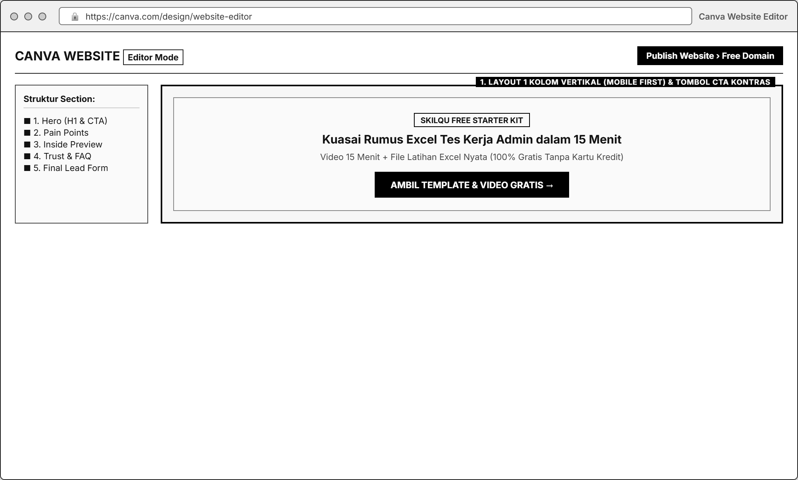
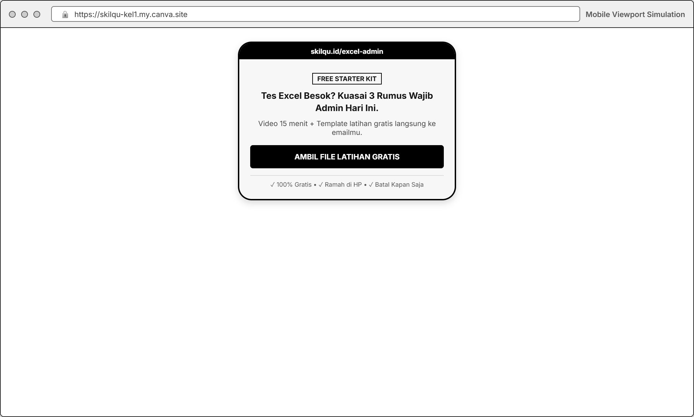
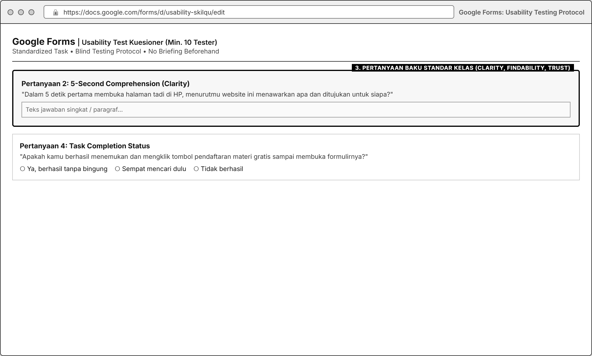

# MODUL 02: LANDING PAGE OPTIMIZATION & USABILITY TESTING (MOBILE-FIRST)
**Mata Kuliah**: Pemasaran Digital (Digital Marketing)  
**Program Studi**: Inovasi Digital, Departemen Sistem Informasi, FTEIC  
**Institusi**: Institut Teknologi Sepuluh Nopember (ITS)  
**Minggu Pelaksanaan**: Minggu ke-2 (Laporan & Presentasi Progres di Minggu ke-3)  
**Tools Praktikum**: Canva Free Website Builder / Vibe Coding (Vercel/Netlify/GitHub Pages), Google Forms, Google Sheets, Bitly / Lynk.id

---

## 1. Pengantar & Tujuan Praktikum

### A. Mengapa Landing Page & Usability Testing Sangat Kritis?
Mendatangkan trafik dari Google (SEO) atau media sosial hanyalah separuh perjalanan. Jika pengunjung mengklik tautan kita tetapi halaman yang mereka buka lambat, membingungkan di layar HP, atau tidak meyakinkan, maka seluruh biaya dan usaha pemasaran di hulu akan terbuang sia-sia.

**Landing Page** adalah halaman web khusus yang dirancang dengan **satu tujuan konversi tunggal (*single conversion goal*)**, berbeda dengan beranda website biasa yang memiliki puluhan menu bercabang. Sedangkan **Usability Testing** adalah metode pengujian langsung kepada pengguna nyata untuk mengukur seberapa mudah, jelas, dan meyakinkan halaman tersebut saat digunakan.

### B. Kaitan Modul 2 dengan Business Case **Skilqu**
Berdasarkan data *baseline* **Skilqu**:
* Dari **2.000 pengunjung *landing page* per bulan**, hanya **100 orang (5,0%)** yang mendaftar **Skilqu Free Starter Kit**.
* **85% pengunjung membuka halaman melalui smartphone (HP)**.
* Kutipan wawancara persona **Nadya Putri (21 thn)** mengungkap penyebab kegagalan halaman lama: *"Kemarin sempat buka web kursus online dari link bio IG di HP, tapi tulisannya kecil-kecil dan disuruh langsung bayar di depan sebelum tahu isi videonya kayak gimana. Akhirnya langsung aku tutup."*

Pada Modul 2 ini, kelompok akan:
1. Mewarisi **Primary Keyword, H1, dan Value Proposition** dari **Modul 1 (SEO)** untuk membangun **Landing Page Skilqu (Mobile-First)** yang menawarkan **Skilqu Free Starter Kit (Rp0)** sekaligus mengenalkan paket lanjutan **Skilqu Pass (Rp49.000/bulan)**.
2. Menjalankan **Standardized Usability Testing** kepada **minimal 10 tester** (mahasiswa tingkat akhir / *fresh graduate*) melalui HP mereka tanpa *briefing* produk sebelumnya.
3. Mengukur KPI Usability & Konversi untuk menemukan titik kebingungan (*friction*) sebelum halaman ini dipromosikan lewat konten Instagram (Modul 3), A/B Testing (Modul 4), dan Meta Ads (Modul 5).

---

## 2. Landasan Teori: Anatomi Mobile-First Landing Page

Agar halaman mampu meningkatkan konversi dari *baseline* **5,0%** menuju target **$\ge$ 8,0%**, halaman wajib dirancang dengan struktur **5 Bagian (*5-Section Mobile Framework*)** berikut:

| Urutan Bagian | Nama Bagian | Fungsi Psikologis bagi Persona Nadya | Elemen Wajib di Layar HP |
| :--- | :--- | :--- | :--- |
| **Bagian 1** | **Hero Section (*Above the Fold*)** | Lulus **Uji 5 Detik (*5-Second Test*)**: Nadya langsung paham ini produk apa, untuk siapa, dan apa yang didapat gratis. | • **Headline (H1)** spesifik dari Modul 1 • **Sub-headline** (Video 15 menit + Template Gratis) • **1 Tombol CTA Utama** warna kontras (`#F59E0B` / `#10B981`) • **Mockup Visual** modul/template Skilqu |
| **Bagian 2** | **Problem & Agitation** | Membuat Nadya merasa *"Ini gue banget!"* dan sadar bahwa sekadar *save* konten IG/nonton YouTube acak tidak cukup. | • 3 poin masalah utama Nadya (ringkas, pakai ikon/poin pendek, bukan paragraf panjang) |
| **Bagian 3** | **Solution & Inside Preview (*What You Get*)** | Menjawab keraguan *"Isi materinya kayak gimana?"* sebelum user diminta mengisi data. | • Cuplikan 3 poin materi di dalam *Free Starter Kit* (Video 15 menit + File Template latihan) • Tabel perbandingan singkat: *YouTube Gratis vs Bootcamp Mahal vs Skilqu* |
| **Bagian 4** | **Trust Elements & Objection Handling (FAQ)** | Membangun kepercayaan dan mematahkan 3 keraguan utama Nadya. | • Testimoni mahasiswa / angka pengguna / cuplikan tampilan template asli • Info transparan tentang **Skilqu Pass Rp49.000/bln** (*bisa coba gratis dulu, batal kapan saja*) |
| **Bagian 5** | **Final CTA & Lead Capture Form** | Menangkap konversi pendaftaran dengan hambatan sekecil mungkin (*low friction*). | • Tombol CTA / Formulir singkat (cukup **Nama, Email, Fokus Track**) • Kalimat penenang di bawah tombol: *"100% Gratis • Langsung dikirim ke email • Tanpa kartu kredit"* |

---

## 3. Spesifikasi Variabel, Kondisi Kontrol, & KPI Utama Modul 2

| Komponen | Spesifikasi yang Dikunci |
| :--- | :--- |
| **Variabel yang Diamati / Diubah** | • **Headline (H1) & Sub-headline** (*Value Proposition*) • **Desain & Copy Tombol CTA** (warna, ukuran, teks ajakan) • **Tata Letak Mobile** (*font size*, kerapatan teks, urutan *section*) • **Trust Element** (pratinjau template, perbandingan fitur, FAQ *objection*) |
| **Kondisi Kontrol (Wajib Sama Antar Kelompok)** | • Perangkat pengujian wajib **Smartphone (Mobile View)** • Minimal **10 Tester per kelompok** (ideal 15-20 tester) yang sesuai profil persona Nadya • Tester **tidak boleh diberi penjelasan produk sebelumnya** (*blind briefing*) • Skenario *Task* dan daftar pertanyaan Google Form **wajib terstandarisasi** |
| **KPI Utama Bisnis (Konversi)** | Pilih salah satu sebagai KPI utama pelacakan tautan: 1. **Landing Conversion Rate** $= \frac{\text{Jumlah Pendaftar Free Starter Kit}}{\text{Total Landing Page Visitors}} \times 100\%$ *(Target $\ge 8{,}0\%$)* 2. **CTA Click Rate** $= \frac{\text{Jumlah Klik Tombol CTA}}{\text{Total Landing Page Visitors}} \times 100\%$ |
| **KPI Utama Usability (Skor Komposit 100%)** | Dihitung dari 5 komponen pengujian terhadap minimal 10 tester: 1. **Task Completion Rate (30%)**: $\frac{\text{Tester yang berhasil sampai tahap daftar}}{\text{Total Tester}} \times 100\%$ *(Target $\ge 80\%$)* 2. **Clarity & 5-Sec Comprehension (20%)**: Pemahaman manfaat & target user (Skala 1-5) 3. **CTA Findability (20%)**: Kemudahan menemukan CTA (Skala 1-5) & *Time on Task* (detik) 4. **Trust Score (15%)**: Tingkat kepercayaan terhadap halaman & penawaran (Skala 1-5) 5. **Quality of Qualitative Insight (15%)**: Ketajaman analisis masukan terbuka tester |

---

## 4. Persiapan Tools Gratis

1. **Pembuatan & Hosting Landing Page (Pilih Salah Satu yang Paling Nyaman bagi Kelompok)**:
   * **Opsi A: Canva Free Website Builder** ([https://www.canva.com/](https://www.canva.com/)): Pilih template *Website / Mobile-First Website*, sesuaikan dengan 5 bagian Skilqu, lalu klik **Publish Website** $\rightarrow$ **Free domain** (`nama-skilqu.my.canva.site`). Pastikan opsi **Resize on mobile** aktif. *(Catatan: 1 akun Canva Free bisa mempublikasikan hingga 5 website gratis).*
   * **Opsi B: Vibe Coding / HTML Statis Gratis**: Membangun halaman responsif *mobile-first* menggunakan HTML/CSS/Tailwind (bisa dibantu AI *code generator*) lalu di-*deploy* gratis ke **Vercel**, **Netlify**, atau **GitHub Pages**.
2. **Formulir Konversi & Pelacakan Klik (Tracking)**:
   * Buat **Formulir Pendaftaran Skilqu Free Starter Kit** (bisa tertanam langsung di halaman atau mengarah ke halaman form khusus yang bersih) yang mencatat **Nama, Email, dan Pilihan Track**.
   * Gunakan **Bitly** (atau parameter UTM / Lynk.id) pada tombol CTA utama agar kelompok bisa melihat jumlah klik tombol (**CTA Clicks**) secara akurat untuk dibandingkan dengan jumlah pengunjung halaman.
3. **Google Forms untuk Usability Testing**:
   * Digunakan oleh tester setelah mereka mencoba menjalankan skenario tugas di *landing page*.

---

## 5. Langkah Praktikum Step-by-Step

### Langkah 1: Menyusun Wireframe & Copywriting 5 Bagian Skilqu
1. Ambil **Primary Keyword, Title Tag, dan H1** yang telah kalian tetapkan di **Modul 1 (SEO)**.
2. Tuliskan draf teks (*copywriting*) untuk ke-5 bagian *landing page* sesuai **Tone of Voice Skilqu** (praktis, *to-the-point*, suportif, bahasa *"Kamu"*).
3. Pastikan di dalam halaman terdapat penjelasan alur produk yang utuh:
   * Penawaran utama halaman ini: **Ambil Skilqu Free Starter Kit (Rp0: Video 15 Menit + Template)**.
   * Informasi produk lanjutan: Setelah mencoba materi gratis, pengguna bisa membuka seluruh 30+ modul dengan **Skilqu Pass (Rp49.000/bulan, bisa batal kapan saja)**.

### Langkah 2: Membangun & Mempublikasikan Landing Page (Mobile-First)
1. Bangun halaman di **Canva Website** atau **Vibe Coding**.

2. **Aturan Wajib Desain Mobile**:
   * Gunakan tata letak **1 kolom vertikal (*single-column layout*)** saat dibuka di layar HP.
   * Ukuran teks judul (*H1*) minimal setara `24px-28px` dan teks isi (*body*) minimal `15px-16px` agar tidak perlu di-*zoom* dengan jari.
   * Tombol CTA utama harus muncul **di layar pertama (*above the fold*)** tanpa harus menggulir (*scroll*) terlalu jauh ke bawah, dan diulang kembali di bagian bawah halaman.
3. Pasang tautan pelacak (Bitly / Form Pendaftaran) pada tombol CTA.
4. Publikasikan halaman dan uji buka URL-nya dari *smartphone* masing-masing anggota kelompok untuk memastikan halaman terbuka cepat dan tidak ada elemen yang terpotong.

### Langkah 3: Menyiapkan Protokol *Standardized Usability Testing*
Agar hasil antar kelompok adil dan tidak bias, **seluruh kelompok wajib mengikuti protokol pengujian standar berikut**:

1. **Kriteria & Jumlah Tester**:
   * Minimal **10 orang tester** di luar anggota kelompok (ideal 15-20 orang).
   * Tester harus sesuai dengan persona **Nadya**: mahasiswa S1 tingkat akhir (Semester 6-8) atau *fresh graduate* yang berencana melamar magang/kerja.
2. **Aturan Tanpa Briefing Produk (*Blind Test*)**:
   * **JANGAN** menjelaskan apa itu Skilqu sebelum tester membuka halaman. Biarkan halaman *landing page* kalian yang berbicara sendiri.
3. **Skenario & Instruksi Tugas Standar (Diberikan Sama kepada Semua Tester)**:
   > *"Bayangkan minggu depan kamu ada panggilan seleksi magang/kerja dan harus siap-siap dalam waktu singkat. Kamu menemukan link halaman ini dari Google/Instagram. Silakan buka link ini di HP kamu: **[URL Landing Page Kelompok]**.*  
   > *Tugasmu:*  
   > *1. Lihat halaman bagian atas selama **5 detik pertama**, lalu ceritakan apa yang kamu tangkap.*  
   > *2. Jelajahi halaman ini, cari cara untuk mendapatkan **materi & template latihan gratisnya (Free Starter Kit)**, lalu klik tombol pendaftarannya sampai kamu menemukan formulir pengisiannya.*  
   > *3. Setelah selesai, isi kuesioner penilaian singkat di Google Form ini: **[URL Google Form Usability]**."*

### Langkah 4: Membuat Kuesioner Google Form Usability (Pertanyaan Standar Kelas)
Buat Google Form pengujian yang memuat **8 Pertanyaan Inti Standar** berikut:

| No | Bagian / KPI yang Diukur | Pertanyaan di Google Form | Format Jawaban |
| :--- | :--- | :--- | :--- |
| 1 | **Identitas & Perangkat Tester** | Nama/Inisial, Semester/Status, dan konfirmasi membuka lewat HP (*Smartphone*). | Isian Singkat & Pilihan Ganda |
| 2 | **5-Second Comprehension (Clarity)** | *"Dalam 5 detik pertama membuka halaman tadi, menurutmu website ini menawarkan apa dan ditujukan untuk siapa?"* | Paragraf Singkat (Kualitatif) |
| 3 | **Value Proposition Clarity** | *"Seberapa jelas manfaat materi gratis (Free Starter Kit) dan bedanya Skilqu dibanding nonton tutorial YouTube biasa?"* | Skala Linear `1` (Sangat Membingungkan) - `5` (Sangat Jelas) |
| 4 | **Task Completion** | *"Apakah kamu berhasil menemukan dan mengklik tombol pendaftaran kelas/template gratis sampai masuk ke formulirnya?"* | Pilihan: `Ya, berhasil tanpa bingung` / `Ya, tapi sempat nyari-nyari dulu` / `Tidak berhasil` |
| 5 | **CTA Findability & Time on Task** | *"Seberapa mudah menemukan tombol pendaftaran (CTA) di layar HP-mu?"* + Perkiraan waktu menemukan tombol (`< 10 detik`, `10-30 detik`, `> 30 detik`). | Skala Linear `1` (Sangat Sulit) - `5` (Sangat Mudah) + Pilihan Waktu |
| 6 | **Trust & Objection Handling** | *"Seberapa percaya kamu untuk mendaftarkan emailmu di halaman ini dan mencoba materinya?"* | Skala Linear `1` (Sangat Ragu) - `5` (Sangat Percaya) |
| 7 | **Conversion Intent** | *"Jika setelah mencoba materi gratisnya ternyata cocok, apakah kamu tertarik mencoba langganan Skilqu Pass (Rp49.000/bulan)?"* | Pilihan: `Ya, tertarik` / `Mungkin, tergantung kebutuhan` / `Tidak tertarik` (beserta alasan singkat) |
| 8 | **Qualitative Friction Insight** | *"Bagian mana dari halaman tadi (teks, desain, ukuran huruf di HP, atau penawaran) yang paling membingungkan atau membuatmu ragu?"* | Paragraf Singkat (Kualitatif) |

### Langkah 5: Mengolah Data & Mendiagnosis Perbaikan Halaman
1. Kumpulkan respons dari minimal 10 tester ke dalam Google Sheets.
2. Hitung metrik berikut lengkap dengan **pembilang dan denominatornya**:
   * **Task Completion Rate (%)**: Contoh `9 dari 10 tester berhasil (90%)`.
   * **Rata-rata Skor Clarity (1-5)**, **CTA Findability (1-5)**, dan **Trust Score (1-5)**.
   * **CTA Click Rate / Landing Conversion Rate** dari *traffic* penguji.
3. Kelompokkan masukan kualitatif (Pertanyaan 2 dan 8) untuk mengidentifikasi **3 Masalah Utama (*Top 3 Usability Issues*)** pada halaman versi pertama (*Landing Page v1*).
4. Tentukan **1 perubahan utama** yang akan diperbaiki atau diadu dalam eksperimen **Modul 4 (A/B Testing)**.

---

## 6. Tugas Kelompok Minggu 2

1. **Bangun & Publikasikan Landing Page Skilqu v1 (Mobile-First)**:
   * Wajib dapat diakses secara publik melalui URL aktif dan mengimplementasikan spesifikasi *On-Page SEO* dari Modul 1.
2. **Jalankan Standardized Usability Testing ke Minimal 10 Tester**:
   * Gunakan skenario tugas dan 8 pertanyaan Google Form standar kelas.
3. **Susun Laporan Audit Landing Page & Usability Testing**:
   * Cantumkan URL *Landing Page* aktif, *screenshot* tampilan halaman di layar HP (*Full Mobile Screenshot* dari Bagian 1 sampai Bagian 5), serta link Google Form & Google Sheets data mentah (*raw responses*).
   * Sajikan tabel perhitungan **KPI Usability & Konversi** lengkap dengan denominatornya.
   * Sajikan analisis **Top 3 Temuan Usability** beserta rencana perbaikan konkretnya.

### Format Pengumpulan Laporan Mingguan
* Dikumpulkan dan dipresentasikan pada awal **Minggu ke-3**.
* **Format Nama File**: `Kelompok X_Modul 2_Landing Page & Usability_Skilqu.pdf` beserta tautan *Live Landing Page* dan *Raw Dataset Sheets*.

---

## 7. Rubrik Penilaian Modul 2 (100 Poin)

| Komponen Penilaian | Bobot | Indikator Penilaian Utama |
| :--- | :--- | :--- |
| **1. Kualitas Landing Page (Mobile-First & Copywriting)** | **25%** | Kesesuaian dengan 5 bagian anatomi halaman, keterbacaan di layar HP, kejelasan *Value Proposition*, dan konsistensi dengan *Tone of Voice* Skilqu & SEO Modul 1. |
| **2. Task Completion & Kepatuhan Protokol Usability** | **25%** | Minimal 10 tester valid sesuai persona, menggunakan skenario standar tanpa *briefing* awal, dan perhitungan *Task Completion Rate* yang jujur ber-denominator. |
| **3. Evaluasi Clarity, CTA Findability, & Trust** | **20%** | Kelengkapan analisis kuantitatif skor *Clarity, CTA Findability, Time on Task,* dan *Trust Score*. |
| **4. Kualitas Insight Kualitatif & Rencana Iterasi** | **30%** | Ketajaman membedah alasan mengapa tester bingung/ragu berdasarkan data verbatim tester, serta rumusan perbaikan yang logis untuk dibawa ke modul berikutnya. |
