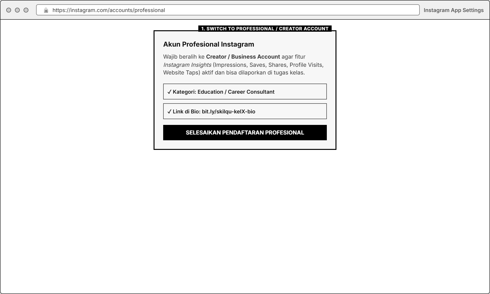
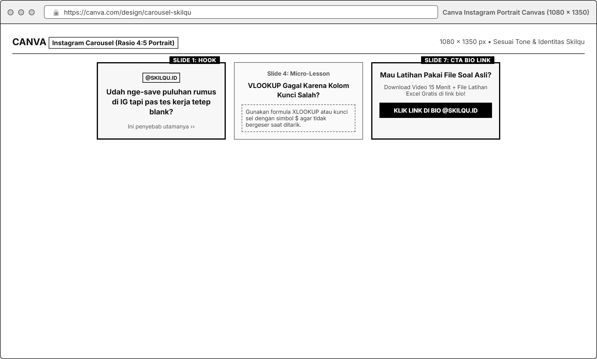
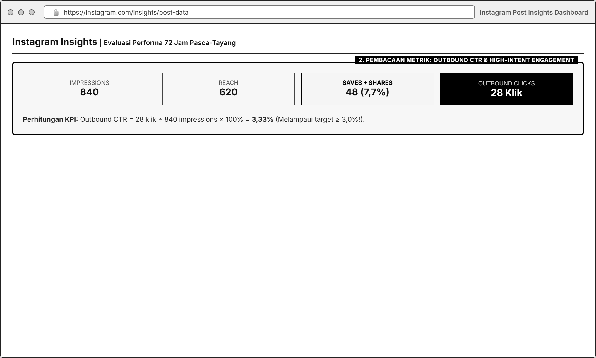

# MODUL 03: CONTENT MAKING & SOCIAL ACQUISITION STRATEGY
**Mata Kuliah**: Pemasaran Digital (Digital Marketing)  
**Program Studi**: Inovasi Digital, Departemen Sistem Informasi, FTEIC  
**Institusi**: Institut Teknologi Sepuluh Nopember (ITS)  
**Minggu Pelaksanaan**: Minggu ke-3 (Laporan & Presentasi Progres di Minggu ke-4)  
**Tools Praktikum**: Canva Free, Instagram (Professional/Creator Account & Instagram Insights), Bitly / Lynk.id, Google Sheets

---

## 1. Pengantar & Tujuan Praktikum

### A. Mengapa Konten Media Sosial Harus Berorientasi Konversi?
Banyak bisnis terjebak membuat konten media sosial yang hanya mengejar *likes* atau tampilan estetik (*vanity metrics*), namun gagal membawa pengunjung ke website atau menghasilkan pendaftar produk. Dalam kerangka *Digital Growth*, konten media sosial berfungsi sebagai **mesin penarik perhatian (*Attract*) yang mengubah pengguna pasif menjadi pengunjung *landing page* aktif**.

### B. Kaitan Modul 3 dengan Business Case **Skilqu**
Pada studi kasus **Skilqu**, persona kita (**Nadya Putri (21 thn)**) setiap hari membuka Instagram dan sering menyimpan (*save*) postingan seputar tips karier, rumus Excel, atau contoh CV. Namun, masalah bisnis Skilqu saat ini adalah:
* **Outbound CTR rata-rata konten Skilqu masih rendah (2,0%)**, artinya dari 1.000 tayangan (*impressions*), hanya 20 orang yang mengklik tautan menuju *landing page*.
* Nadya merasa konten yang ia lihat di Instagram sudah "cukup disimpan saja" tanpa ada dorongan kuat untuk mengklik link di bio dan mengambil **Skilqu Free Starter Kit** di *landing page*.

Oleh karena itu, tujuan praktikum Modul 3 adalah:
1. Merancang strategi konten Instagram untuk **Skilqu** (sesuai *Product Track* kelompok: Excel / CV ATS / Interview) yang didasarkan pada **hipotesis terukur (*Content Hypothesis*)**.
2. Memproduksi aset konten menggunakan kerangka **Hook $\rightarrow$ Retain $\rightarrow$ Reward $\rightarrow$ CTA** di Canva sesuai identitas visual dan *Tone of Voice* Skilqu.
3. Mengukur kemampuan konten dalam mendorong trafik keluar menuju **Landing Page Modul 2** menggunakan metrik **Outbound CTR** serta mendiagnosis kualitas interaksi melalui **Saves & Shares**.

---

## 2. Landasan Teori: Kerangka *Hook - Retain - Reward - CTA*

Agar Nadya berhenti melakukan *scrolling* (*stop the scroll*) dan terdorong mengklik link di bio Skilqu, setiap konten wajib dibangun dengan struktur 4 tahap berikut:

| Tahap | Bagian Konten | Tujuan Psikologis | Contoh Implementasi pada Skilqu |
| :--- | :--- | :--- | :--- |
| **1. HOOK** | Slide 1 (Carousel) atau 3 Detik Pertama (Reels) | Menghentikan *scroll* dengan menyentuh *pain point*, *trigger*, atau kesalahan spesifik Nadya. | *"Udah nge-save puluhan rumus Excel di IG, tapi pas tes kerja kemarin tetep blank? Ini biang keroknya..."* |
| **2. RETAIN** | Slide 2-5 atau Detik 04-20 | Menahan perhatian pembaca dengan membedah masalah secara ringkas dan visual. | Menunjukkan perbandingan cara salah vs cara benar menggunakan VLOOKUP/XLOOKUP saat tes admin. |
| **3. REWARD** | Slide 6-7 atau Detik 21-35 | Memberikan **1 *quick win* (ilmu praktis)** yang langsung terasa manfaatnya, namun menyisakan kebutuhan untuk **praktik langsung pakai file**. | Memberikan contekan struktur rumus, lalu mengingatkan: *"Hafal rumusnya aja nggak cukup kalau belum nyoba di tabel soal asli."* |
| **4. CTA** | Slide Terakhir + Baris Pertama & Terakhir Caption | Mengajak audiens melakukan **1 tindakan spesifik**: klik link di bio untuk mengambil *Free Starter Kit*. | *"Mau coba kerjain langsung pakai file soal aslinya? Ambil Video 15 Menit + File Latihan Excel Gratis di link bio @skilqu.id sekarang!"* |

### Tiga Pilihan *Content Angle* (Sudut Pandang Pesan) untuk Skilqu
Kelompok dapat memilih dan menguji salah satu dari 3 sudut pandang psikologis berikut:
1. **Angle A: Problem & Fear of Mistake (Menghindari Kesalahan Fatal)**: Mengangkat kesalahan umum pelamar saat tes Excel / screening CV ATS / interview HR yang sering membuat mereka gugur.
2. **Angle B: Quick Win & Cheat Sheet (Solusi Cepat & Ringkas)**: Menunjukkan cara menyelesaikan tugas/soal sulit hanya dalam 3 langkah atau 15 menit.
3. **Angle C: Reality Check / Myth-Busting (Membedah Kebiasaan Buruk)**: Menyentil kebiasaan mahasiswa yang hanya menimbun *saved posts* atau menonton video 2 jam tanpa pernah latihan praktik.

---

## 3. Spesifikasi Variabel, Kondisi Kontrol, & KPI Utama Modul 3

| Komponen | Spesifikasi yang Dikunci |
| :--- | :--- |
| **Variabel yang Diamati / Diubah** | • **Hook** (Kalimat pembuka & visual di Slide 1 / 3 detik pertama) • **Content Angle** (*Problem-Agitation* vs *Quick-Win Cheat Sheet* vs *Myth-Busting*) • **Format Konten** (*Instagram Carousel* 5-8 slide vs *Instagram Reels* 15-45 detik) • **Caption & Call-to-Action (CTA)** |
| **Kondisi Kontrol (Wajib Sama Antar Kelompok)** | • Platform wajib **Instagram** (menggunakan mode **Professional / Creator Account** agar *Instagram Insights* aktif) • Destinasi tautan wajib mengarah ke **Landing Page Skilqu (Modul 2)** milik kelompok menggunakan tautan pelacak (*Bitly / UTM / Lynk.id*) • Konten **tidak boleh dihapus** selama periode evaluasi kelas • Mematuhi **Brand Identity & Tone of Voice Skilqu** (Modul 00) |
| **KPI Utama (*Primary KPI*)** | **Outbound CTR (Click-Through Rate)** $$\text{Outbound CTR} = \frac{\text{Outbound Clicks (Klik Link Bio menuju Landing Page)}}{\text{Total Impressions}} \times 100\%$$ *Target Kelas*: **$\ge 3{,}0\%$** (meningkat dari *baseline* Skilqu 2,0%). |
| **Metrik Pendukung (*Diagnostic Metrics*)** | 1. **High-Intent Engagement Rate** $= \frac{\text{Saves} + \text{Shares} + \text{Comments}}{\text{Reach}} \times 100\%$ 2. **Save Rate** $= \frac{\text{Saves}}{\text{Reach}} \times 100\%$ *(Mengukur seberapa bermanfaat materi bagi Nadya)* 3. **Profile Visit Rate** $= \frac{\text{Profile Visits}}{\text{Reach}} \times 100\%$ *(Mengukur kekuatan CTA di dalam konten untuk membawa orang ke profil)* 4. **Bio Link Conversion Rate** $= \frac{\text{Bio Link Clicks}}{\text{Profile Visits}} \times 100\%$ *(Mengukur kejelasan bio IG)* |
| **Guardrail Penilaian** | **Likes dan jumlah Followers BUKAN KPI utama.** Konten dengan *likes* sedikit tetapi memiliki *Save Rate* dan *Outbound CTR* tinggi dengan hipotesis yang tajam akan mendapat nilai lebih tinggi. |

---

## 4. Persiapan Tools Gratis

1. **Akun Instagram Professional / Creator (Gratis)**:
   * Buat akun Instagram khusus proyek kelompok (contoh: `@skilqu.excel.id` atau akun praktikum kelompok) lalu ubah pengaturannya ke **Professional Account (Creator/Business)** melalui menu *Settings and activity* $\rightarrow$ *Account type and tools* $\rightarrow$ *Switch to professional account*.
   * Langkah ini **wajib** dilakukan karena akun pribadi biasa tidak menampilkan data **Impressions, Reach, Profile Visits, Saves, Shares, dan Website Taps**.

2. **Optimasi Bio Instagram & Link Tracking**:
   * Pasang foto profil, bio singkat 3 baris sesuai identitas Skilqu, dan **1 link pelacak (Bitly / Lynk.id)** yang langsung mengarah ke **Landing Page Modul 2** kalian.
3. **Canva Free**:
   * Gunakan ukuran kanvas **Instagram Portrait (`1080 x 1350 px`, rasio 4:5)** untuk *Carousel* (karena memenuhi layar HP lebih luas dibanding ukuran kotak 1:1) atau **Instagram Reels (`1080 x 1920 px`, rasio 9:16)**.

---

## 5. Langkah Praktikum Step-by-Step

### Langkah 1: Menyusun *Content Plan* & *Content Hypothesis Card*
Sebelum membuka Canva, kelompok wajib merumuskan **Content Hypothesis Card** untuk minimal **2 konten** yang akan dipublikasikan minggu ini:
* **Rumus Hipotesis Konten**:
  > *"Karena persona Nadya mengalami masalah **[Pain Point/Trigger spesifik]**, jika kita membuat konten berformat **[Carousel/Reels]** dengan sudut pandang **[Content Angle]** dan Hook **[Kalimat Hook]**, maka kita memprediksi akan mencapai **Outbound CTR minimal [X]%** (minimal **[Y] klik** dari **[Z] impressions**) menuju Landing Page Skilqu."*

### Langkah 2: Menulis Storyboard Slide-by-Slide / Script Reels
Susun naskah konten dengan alur yang ketat:
1. **Slide 1 (Hook)**: Maksimal 10-12 kata dengan ukuran huruf besar dan kontras tinggi. Harus relevan dengan kata kunci yang sudah diriset di Modul 1 dan masalah halaman di Modul 2.
2. **Slide 2 (Relatable Problem)**: Gambarkan situasi nyata yang dialami Nadya (misal: layar Excel error `#N/A` saat tes kerja, atau CV langsung ditolak sistem dalam 24 jam).
3. **Slide 3-5 (Core Value / Micro-Lesson)**: Berikan penjelasan praktis yang mudah dicerna di layar HP. Hindari menaruh teks paragraf panjang dalam satu slide.
4. **Slide 6 (Bridge to Landing Page)**: Jelaskan bahwa membaca slide saja tidak cukup: mereka perlu mencoba langsung menggunakan **Template + Video 15 Menit di Skilqu Free Starter Kit**.
5. **Slide 7 (Clear CTA)**: Instruksi visual yang jelas: *"Klik link di bio `@nama_akun` untuk download Template + Video 15 Menit Gratis (Rp0)!"*

### Langkah 3: Produksi Visual di Canva Sesuai Brand Guideline Skilqu
1. Gunakan palet warna resmi Skilqu dari **Modul 00**:
   * Navy `#0F172A` & Royal Blue `#2563EB` sebagai warna identitas utama.
   * Amber `#F59E0B` sebagai penegas kata kunci pada *Hook* dan kotak *Call-to-Action*.
   * Latar terang `#FFFFFF` / `#F8FAFC` pada slide penjelasan agar nyaman dibaca.
2. Tulis *Caption* Instagram dengan struktur 3 bagian:

   * **Baris 1 (Hook Caption)**: Kalimat pancingan sebelum tombol *"...more"* diklik.
   * **Isi Ringkas**: Rangkuman 3 poin manfaat *Free Starter Kit* dan alasan kenapa lebih praktis dari YouTube.
   * **CTA & Hashtags**: Ajakan klik link di bio + 5-8 *hashtag* relevan sesuai hasil riset keyword Modul 1.

### Langkah 4: Publikasi, Distribusi Awal, & Pengumpulan Data
1. Publikasikan minimal **2 konten** pada akun Instagram kelompok.
2. Agar eksperimen memperoleh *Impressions* awal yang cukup untuk dianalisis (minimal 100-300 *impressions* per post), kelompok diperbolehkan membagikan postingan tersebut ke jaringan mahasiswa/komunitas kampus yang sesuai dengan target persona Nadya (tanpa memaksa mereka mengklik link bio, biarkan mereka mengklik hanya jika tertarik pada isi konten!).
3. Pantau data **Instagram Insights** dan **Bitly/Lynk.id Dashboard** setelah **48-72 jam** tayang.
4. Catat seluruh metrik beserta *screenshot* buktinya:

   * Tanggal & Jam Tayang, URL Postingan
   * *Reach*, *Impressions*, *Likes*, *Comments*, *Saves*, *Shares*
   * *Profile Visits*, *Outbound / Bio Link Clicks*, dan *Landing Page Visits*.

---

## 6. Tugas Kelompok Minggu 3

1. **Susun Content Plan & 2 Content Hypothesis Cards**:
   * Jelaskan keterkaitan topik konten dengan hasil **SEO Keyword (Modul 1)** dan temuan **Usability Landing Page (Modul 2)**.
2. **Produksi & Publikasikan Minimal 2 Konten Instagram (Carousel / Reels)**:
   * Wajib menerapkan struktur *Hook-Retain-Reward-CTA* dan mematuhi *Brand Identity & Tone* Skilqu.
3. **Laporkan Data Performa Funnel Konten (Ber-Denominator)**:
   * Sajikan tabel metrik lengkap dari *Impressions $\rightarrow$ Reach $\rightarrow$ Saves/Shares $\rightarrow$ Profile Visits $\rightarrow$ Bio Link Clicks $\rightarrow$ Landing Page Sign-ups*.
   * Hitung **Outbound CTR** dan **High-Intent Engagement Rate** lengkap dengan angka pembilang dan penyebutnya.
   * Evaluasi: Konten mana yang performanya lebih baik, di tahap mana terjadi *drop-off* terbesar (misal: banyak yang *Save* tapi sedikit yang *Profile Visit*), dan variabel apa yang akan kalian uji pada **Modul 4 (A/B Testing)** minggu depan.

### Format Pengumpulan Laporan Mingguan
* Dikumpulkan dan dipresentasikan pada awal **Minggu ke-4**.
* **Format Nama File**: `Kelompok X_Modul 3_Content Making_Skilqu.pdf` beserta tautan postingan Instagram aktif.

---

## 7. Rubrik Penilaian Modul 3 (100 Poin)

| Komponen Penilaian | Bobot | Indikator Penilaian Utama |
| :--- | :--- | :--- |
| **1. Kualitas Content Hypothesis & Keselarasan Persona** | **25%** | Hipotesis memiliki struktur jelas (*Masalah Persona + Variabel Konten + Target KPI ber-denominator*) serta nyambung dengan Modul 1 & 2. |
| **2. Eksekusi Visual, Struktur Hook-Retain-Reward-CTA, & Brand Tone** | **30%** | Kekuatan *Hook* di slide pertama/3 detik awal, kejelasan materi mikro, kepatuhan pada warna & *Tone of Voice* Skilqu, serta kejelasan CTA. |
| **3. Kelengkapan Data & Akurasi Perhitungan KPI** | **20%** | Bukti *screenshot* Instagram Insights & Link Tracker asli; perhitungan *Outbound CTR, Save Rate,* dan *Profile Visit Rate* benar dengan denominator. |
| **4. Diagnosis Bottleneck & Rekomendasi untuk A/B Test** | **25%** | Kemampuan membaca mengapa sebuah konten berhasil/gagal mendorong klik (bukan sekadar menyalahkan algoritma) dan mengusulkan ide tes untuk Modul 4. |
