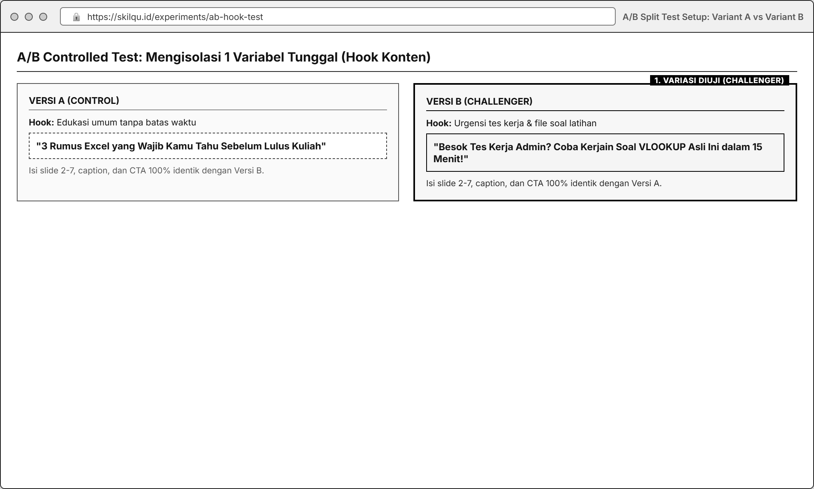
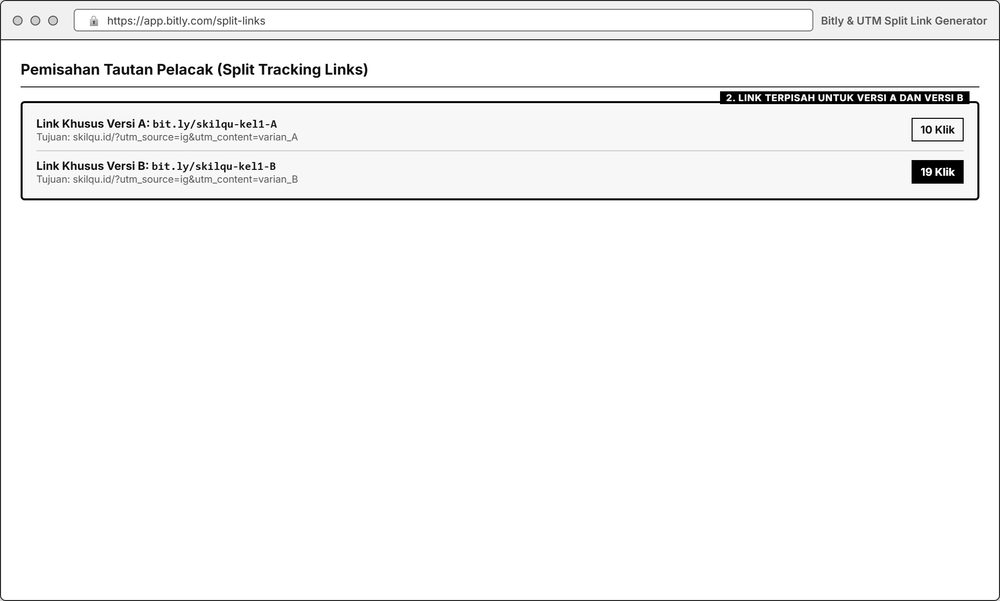
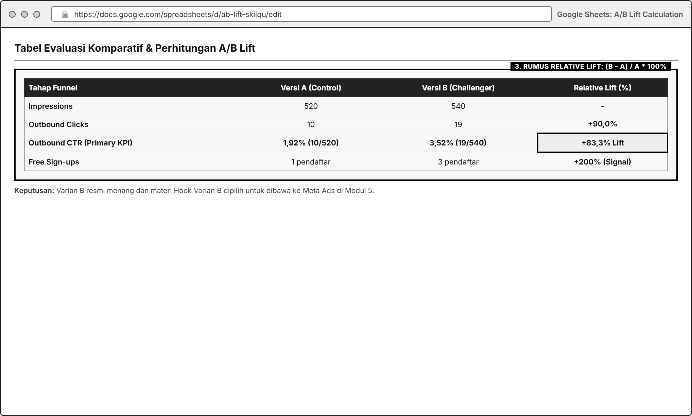

# MODUL 04: CONTROLLED EXPERIMENTATION & A/B TESTING
**Mata Kuliah**: Pemasaran Digital (Digital Marketing)  
**Program Studi**: Inovasi Digital, Departemen Sistem Informasi, FTEIC  
**Institusi**: Institut Teknologi Sepuluh Nopember (ITS)  
**Minggu Pelaksanaan**: Minggu ke-4 (Laporan & Presentasi Progres di Minggu ke-5)  
**Tools Praktikum**: Instagram Professional / Canva Website, Bitly / UTM Builder / Lynk.id, Google Sheets

---

## 1. Pengantar & Tujuan Praktikum

### A. Mengapa Growth Marketer Tidak Boleh Menebak-nebak?
Dalam pemasaran digital, opini tim (*"Menurutku judul ini lebih keren"* atau *"Warna tombol biru kayaknya lebih bagus"*) sering kali meleset saat berhadapan dengan perilaku pengguna nyata. **A/B Testing (Split Testing)** adalah metode eksperimen terkontrol untuk membandingkan dua versi aset pemasaran (**Versi A / Control** vs **Versi B / Variant**) guna membuktikan secara empiris versi mana yang menghasilkan performa KPI lebih tinggi.

### B. Kaitan Modul 4 dengan Business Case **Skilqu**
Setelah menjalankan **Modul 2 (Landing Page)** dan **Modul 3 (Content Making)**, setiap kelompok kini memiliki data awal: berapa banyak orang yang melihat konten, mengklik link, dan mendaftar **Skilqu Free Starter Kit**.

Sebelum kelompok diberikan anggaran iklan berbayar pada **Minggu ke-5 (Modul 5: Meta Ads)**, kelompok harus memastikan bahwa pesan (*hook / headline / CTA*) yang akan diiklankan sudah teruji. Tujuan Modul 4 adalah:
1. Mengidentifikasi satu hambatan konversi (*bottleneck*) dari hasil Modul 2 atau Modul 3.
2. Merancang dan menjalankan **1 eksperimen A/B yang valid** dengan mengubah **hanya satu variabel utama** sementara kondisi lainnya dijaga tetap sama (*controlled condition*).
3. Menghitung **A/B Lift (%)**, mengevaluasi keterbatasan sampel data, dan memilih **Winning Variant** yang akan di-*scale* menggunakan **Meta Ads** di Modul 5.

---

## 2. Landasan Teori: Aturan Emas Eksperimen A/B yang Valid

Banyak pemula gagal melakukan A/B Testing karena melanggar prinsip isolasi variabel. Perhatikan perbedaan eksperimen yang **Valid** vs **Tidak Valid** berikut:

| Aspek | Eksperimen TIDAK VALID (Dilarang!) | Eksperimen VALID (Standar Kelas) |
| :--- | :--- | :--- |
| **Jumlah Variabel yang Diubah** | Mengubah *Hook*, mengganti format dari Carousel ke Reels, sekaligus mengganti topik dari Excel ke CV. *(Jika menang, kita tidak tahu variabel mana penyebabnya!)* | Hanya mengubah **1 variabel utama** (contoh: **Hook Slide 1 Versi A** vs **Hook Slide 1 Versi B**), sedangkan isi slide 2-7, warna, dan topik tetap identik. |
| **Perbandingan Platform** | Memposting Versi A di Instagram dan Versi B di TikTok, lalu membandingkan hasilnya. *(Beda algoritma & audiens bukan A/B test!)* | Kedua versi diuji pada **platform dan segmen audiens yang sama**. |
| **Pelacakan Klik (Tracking)** | Versi A dan Versi B memakai 1 link Bitly yang sama sehingga tidak tahu klik berasal dari versi yang mana. | Versi A memakai **Link Pelacak A** (`bit.ly/skilqu-kel1-A`) dan Versi B memakai **Link Pelacak B** (`bit.ly/skilqu-kel1-B`). |
| **Cara Menyimpulkan Hasil** | *"Versi B menang telak 100% dibanding Versi A!"* padahal hanya dari 2 klik vs 1 klik. | Menyertakan **angka pembilang, denominator, perhitungan Lift**, serta catatan jujur mengenai kecukupan ukuran sampel (*sample size validity*). |

---

## 3. Spesifikasi Variabel, Kondisi Kontrol, & KPI Utama Modul 4

| Komponen | Spesifikasi yang Dikunci |
| :--- | :--- |
| **Variabel Eksperimen (Pilih 1 Variabel Tunggal untuk Diuji)** | Kelompok wajib memilih **SATU** dari opsi variabel eksperimen berikut: • **Opsi 1: Hook Konten (Slide 1 / 3 Detik Awal)**: *Hook A (Problem/Fear Angle)* vs *Hook B (Benefit/Free Template Angle)* • **Opsi 2: Format Penyajian Konten**: *Format A (Carousel Step-by-Step)* vs *Format B (Reels Singkat)* dengan naskah inti dan Hook yang sama • **Opsi 3: Hero Headline / CTA Landing Page**: *Headline/CTA Versi A* vs *Headline/CTA Versi B* pada halaman *Skilqu Free Starter Kit* |
| **Kondisi Kontrol (*Control Variables*)** | • **Product Track & Penawaran**: Tetap sama (*Skilqu Free Starter Kit* pada Track pilihan kelompok) • **Platform & Audiens**: Diuji pada kanal dan kelompok target mahasiswa yang setara • **Waktu & Durasi Evaluasi**: Dipublikasikan pada jendela waktu yang setara dan diamati dalam durasi yang sama (misal: sama-sama 72 jam) • **Unsur Lain di Luar Variabel Uji**: Wajib dijaga identik |
| **KPI Utama (*Primary KPI*)** | Tetapkan **1 KPI Utama** sebelum tes dijalankan: • Jika menguji **Konten (Opsi 1 / 2)**: **Outbound CTR** $= \frac{\text{Outbound Clicks}}{\text{Impressions}} \times 100\%$ • Jika menguji **Landing Page (Opsi 3)**: **Landing Conversion Rate** $= \frac{\text{Free Starter Kit Sign-ups}}{\text{Landing Visitors}} \times 100\%$ atau **CTA Click Rate** |
| **Rumus Perhitungan A/B Lift** | $$\text{Relative Lift (\%)} = \frac{\text{KPI Versi B} - \text{KPI Versi A}}{\text{KPI Versi A}} \times 100\%$$ *Contoh*: Jika Outbound CTR Versi A = $2{,}0\%$ ($10/500$) dan Versi B = $3{,}2\%$ ($16/500$), maka: $$\text{Lift} = \frac{3{,}2\% - 2{,}0\%}{2{,}0\%} \times 100\% = +60{,}0\%$$ |
| **Metrik Pendukung** | *Reach, Impressions, Saves, Shares, Profile Visits, Landing Page Visits,* dan *Free Sign-ups* pada masing-masing varian (A dan B). |

---

## 4. Langkah Praktikum Step-by-Step

### Langkah 1: Diagnosis Bottleneck dari Modul 2 & Modul 3
Lihat kembali data kelompok kalian dari minggu sebelumnya:
* **Kasus 1**: Jika di Modul 3 *Impressions/Reach* cukup banyak tetapi **Outbound CTR masih di bawah 3,0%** (sedikit yang klik ke *landing page*), maka masalah utama ada di **Hook atau CTA Konten**. Pilih **Opsi 1 atau Opsi 2**.
* **Kasus 2**: Jika di Modul 2/3 sudah banyak yang masuk ke *landing page* tetapi **Landing Conversion Rate masih di bawah 8,0%**, maka masalah utama ada di **Headline atau Tombol CTA Landing Page**. Pilih **Opsi 3**.

### Langkah 2: Menyusun *A/B Experiment Card* (Sebelum Eksekusi)
Isi tabel perencanaan eksperimen berikut sebelum membuat atau mempublikasikan materi:

| Komponen Experiment Card | Isi Rencana Kelompok (Contoh: Opsi 1 - Hook Konten Track Excel) |
| :--- | :--- |
| **Masalah / Evidence Awal** | Pada Modul 3, konten kami mendapat 450 *impressions* dan 28 *saves*, tetapi hanya menghasilkan 7 klik (*Outbound CTR = 1,55%*). Banyak yang *save* tapi tidak merasa perlu ambil file latihan di link bio. |
| **Variabel yang Diubah** | **Kalimat Hook pada Slide 1** (Slide 2-7, warna desain, dan caption bagian isi dibuat 100% sama). |
| **Versi A (Control)** | Hook fokus pada **Tips Umum**: *"3 Rumus Excel yang Wajib Kamu Tahu Sebelum Lulus Kuliah"* |
| **Versi B (Variant / Challenger)** | Hook fokus pada **Urgensi Tes Kerja & File Latihan**: *"Besok Tes Kerja Admin? Jangan Cuma Dihafal, Coba Kerjain Soal VLOOKUP Asli Ini dalam 15 Menit!"* |
| **Hipotesis Terstruktur** | **Jika** kita mengubah Hook Slide 1 dari edukasi umum (Versi A) menjadi urgensi soal tes kerja + ajakan coba file latihan (Versi B), **maka** *Outbound CTR* akan naik dari $<2\%$ menjadi $\ge 3{,}0\%$, **karena** persona Nadya baru terdorong mengklik link jika tahu ada file soal nyata yang bisa langsung dicoba. |
| **KPI Utama & Target** | **Outbound CTR** ($\text{Klik Link Bio} \div \text{Impressions} \times 100\%$), dengan target minimal 300 *impressions* per varian. |
| **Kondisi Kontrol** | Diposting di Instagram kelompok pada jam yang setara (pukul 19.00 WIB), durasi pantau 72 jam, memakai 2 link pelacak terpisah (`bit.ly/skilqu-A` vs `bit.ly/skilqu-B`). |

### Langkah 3: Menyiapkan Infrastruktur Pelacakan Terpisah (Split Tracking)
Agar data klik dan pendaftar dari **Versi A** dan **Versi B** tidak tercampur:

1. Buat **2 Shortlink / UTM Link berbeda** yang mengarah ke *Landing Page* kelompok:
   * Link Khusus Versi A: `https:// halaman-skilqu.com/?utm_source=ig&utm_content=varian_A` (pendekkan di Bitly menjadi link A).
   * Link Khusus Versi B: `https:// halaman-skilqu.com/?utm_source=ig&utm_content=varian_B` (pendekkan di Bitly menjadi link B).
   * *(Tips Praktis: Jika menggunakan Lynk.id atau halaman jembatan di bio IG, kalian bisa memasang tombol yang sesuai atau mengganti link bio sesuai jendela pengujian masing-masing varian dengan durasi tayang yang sama persis, atau mendistribusikan ke dua kelompok responden mahasiswa yang setara dan terpisah).*

### Langkah 4: Eksekusi & Pencatatan Tabel Funnel Komparatif
Setelah kedua varian berjalan selama durasi pengamatan yang ditentukan, catat seluruh tahap funnel secara berdampingan:

| Tahap Funnel / Metrik | Versi A (Control) | Versi B (Variant) | Selisih / A/B Lift (%) |
| :--- | :--- | :--- | :--- |
| **1. Impressions** | *(contoh: 520)* | *(contoh: 540)* | - |
| **2. Reach** | *(contoh: 410)* | *(contoh: 430)* | - |
| **3. Saves + Shares** | *(contoh: 22 / 5,37% dari Reach)* | *(contoh: 31 / 7,21% dari Reach)* | `+34,3%` |
| **4. Outbound Clicks (Landing Visits)** | *(contoh: 10 klik)* | *(contoh: 19 klik)* | - |
| **5. KPI Utama: Outbound CTR (%)** | **1,92%** (`10 ÷ 520`) | **3,52%** (`19 ÷ 540`) | **Lift = +83,3%** |
| **6. Free Starter Kit Sign-ups** | *(contoh: 1 pendaftar / 10,0%)* | *(contoh: 3 pendaftar / 15,8%)* | `+58,0%` |

### Langkah 5: Evaluasi Validitas Data & Keputusan untuk Modul 5 (Meta Ads)
Jangan langsung berhenti setelah menghitung persentase *Lift*. Jawab 3 pertanyaan analisis kritis berikut:
1. **Apakah jumlah sampel (*denominator*) sudah cukup memadai?**  
   Jika *Lift* terlihat tinggi (misal $+100\%$) tetapi hanya berasal dari `2 klik dari 40 impressions` vs `1 klik dari 40 impressions`, kelompok **wajib menyatakan bahwa hasil tersebut masih indikasi awal (*directional signal*) dan belum konklusif secara statistik** karena sampel terlalu kecil.
2. **Mengapa Varian Pemenang bekerja lebih baik pada psikologi Nadya?**  
   Hubungkan hasil angka dengan *pain point*, *trigger*, atau *objection* Nadya.
3. **Apa yang akan dibawa ke Modul 5 (Meta Ads)?**  
   Tetapkan varian pemenang (atau kombinasi elemen terbaik dari A dan B) yang akan dijadikan materi iklan berbayar (*Ad Creative*) pada minggu ke-5.

---

## 5. Tugas Kelompok Minggu 4

1. **Susun A/B Experiment Card Lengkap**:
   * Memuat bukti masalah dari Modul 2/3, 1 variabel yang diubah, daftar variabel kontrol, rumusan hipotesis, dan penetapan 1 KPI utama.
2. **Jalankan Eksperimen Versi A vs Versi B**:
   * Tampilkan *screenshot* berdampingan (*side-by-side comparison*) antara **Versi A** dan **Versi B** dengan penanda jelas bagian mana yang diubah dan bagian mana yang dijaga sama.
3. **Sajikan Tabel Hasil Funnel, Perhitungan Lift, & Keputusan**:
   * Sertakan bukti *screenshot* metrik kedua varian (Instagram Insights + Bitly/Link Tracker + Form Pendaftaran).
   * Hitung **Relative Lift (%)** lengkap dengan pembilang dan denominatornya.
   * Berikan rekomendasi tegas: **Varian mana yang dipilih untuk dijalankan di Meta Ads (Modul 5)** beserta alasannya.

### Format Pengumpulan Laporan Mingguan
* Dikumpulkan dan dipresentasikan pada awal **Minggu ke-5**.
* **Format Nama File**: `Kelompok X_Modul 4_AB Testing_Skilqu.pdf` beserta link bukti eksperimen di Google Sheets.

---

## 6. Rubrik Penilaian Modul 4 (100 Poin)

| Komponen Penilaian | Bobot | Indikator Penilaian Utama |
| :--- | :--- | :--- |
| **1. Disiplin Isolasi Variabel & Kondisi Kontrol** | **30%** | Hanya mengubah **1 variabel utama** yang jelas; kondisi lainnya (platform, topik, desain dasar, durasi) benar-benar dijaga terkontrol. |
| **2. Kualitas Hipotesis & Desain Eksperimen** | **20%** | Hipotesis berbasis data masalah Modul 2/3 dan memiliki alasan psikologis yang kuat terhadap persona Nadya. |
| **3. Akurasi Perhitungan KPI, Denominator, & A/B Lift** | **25%** | Pelacakan klik/konversi Varian A dan B terpisah dengan benar; rumus *Lift* tepat; wajib mencantumkan angka pembilang dan penyebut. |
| **4. Kejujuran Evaluasi Validitas & Keputusan Next Step** | **25%** | Mampu menilai keterbatasan ukuran sampel secara kritis (tidak *overclaim*) dan memberikan keputusan logis untuk kampanye Meta Ads di Modul 5. |
