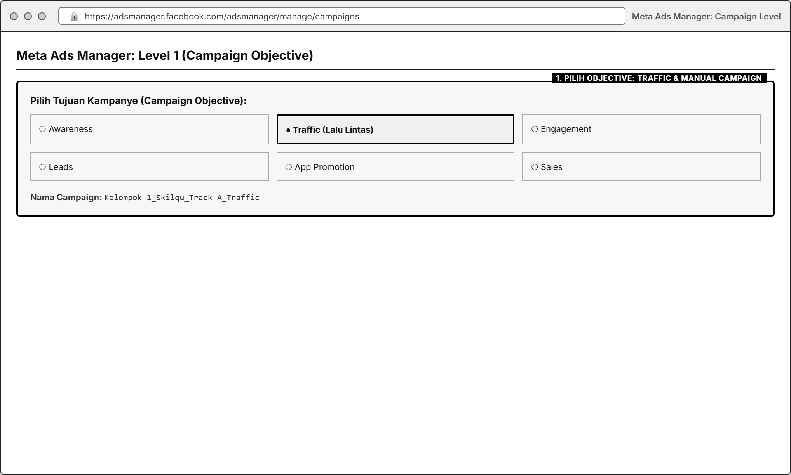
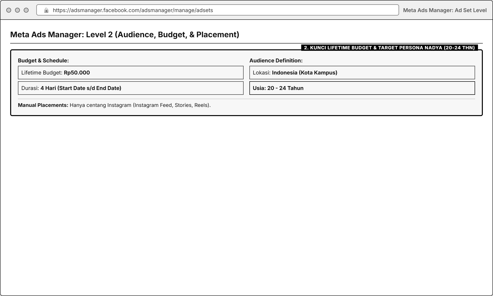
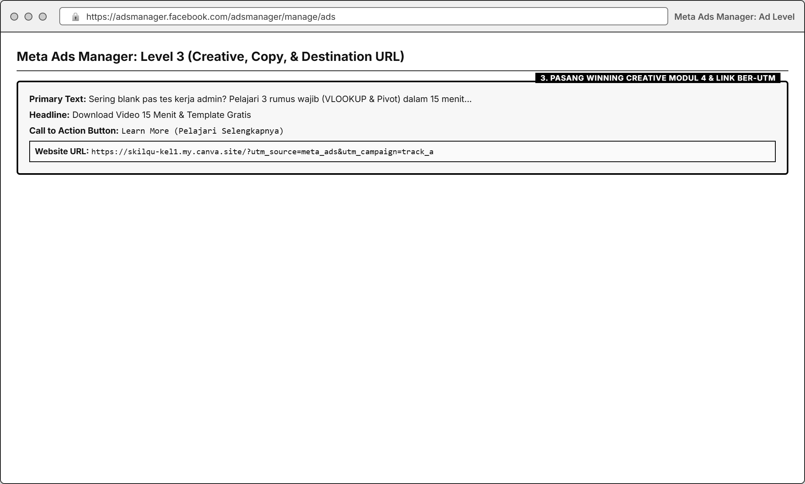
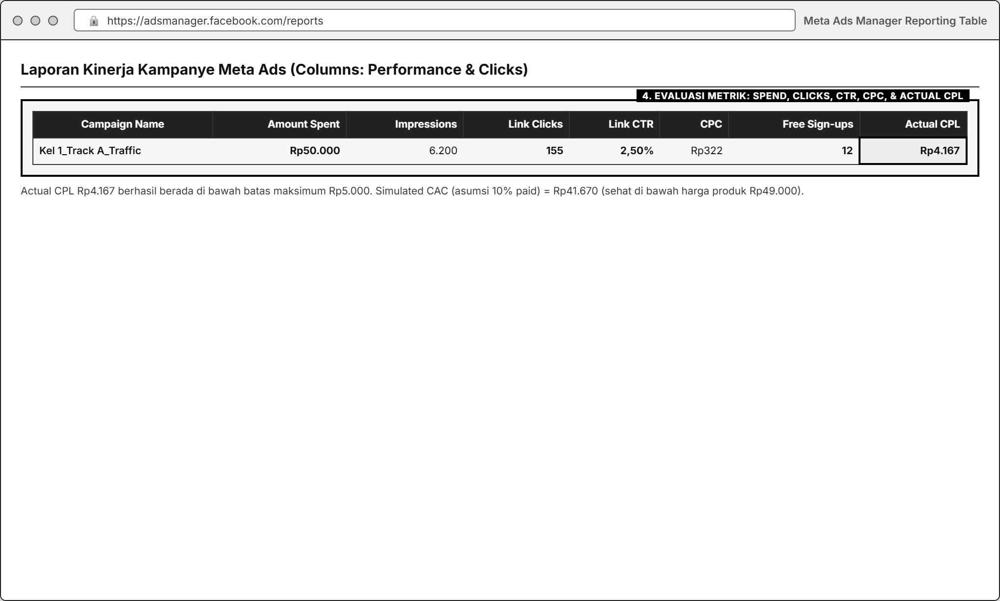

# MODUL 05: PAID ACQUISITION DENGAN META ADS (CPL, CAC, & ROAS)
**Mata Kuliah**: Pemasaran Digital (Digital Marketing)  
**Program Studi**: Inovasi Digital, Departemen Sistem Informasi, FTEIC  
**Institusi**: Institut Teknologi Sepuluh Nopember (ITS)  
**Minggu Pelaksanaan**: Minggu ke-5 (Laporan & Presentasi Progres di Minggu ke-6)  
**Tools Praktikum**: Meta Ads Manager (Facebook & Instagram Ads), Landing Page Skilqu (Modul 2), Winning Creative (Modul 4), Bitly / UTM Parameter, Google Sheets

---

## 1. Pengantar & Tujuan Praktikum

### A. Dari Eksperimen Organik ke Akuisisi Berbayar (*Paid Acquisition*)
Konten organik (Modul 3) dan eksperimen A/B (Modul 4) sangat baik untuk memvalidasi pesan apa yang disukai audiens, namun jangkauan organik membutuhkan waktu dan sulit diprediksi volumenya. Ketika sebuah bisnis sudah menemukan **Landing Page yang teruji (Modul 2)** dan **Materi Konten pemenang (Modul 4)**, langkah berikutnya adalah mempercepat pertumbuhan menggunakan **iklan berbayar (*Paid Ads*)** di **Meta Ads (Instagram & Facebook)**.

### B. Analogi Mudah: E-Commerce Ads vs Meta Ads
Jika kamu pernah melihat cara kerja iklan di *marketplace* (seperti Shopee/Tokopedia Ads), prinsip dasarnya sama: kita membayar agar produk tampil di depan calon pembeli, lalu mengukur **Biaya Iklan (*Spend*)**, **Klik (*Clicks / CTR / CPC*)**, **Konversi**, dan **Efisiensi Balik Modal (*ROAS / CAC*)**.

Perbedaan utamanya di **Meta Ads**:
1. Pengguna di Instagram **tidak sedang mengetik kata kunci belanja**, sehingga kita menargetkan mereka berdasarkan **Demografi, Minat (*Interests*), dan Perilaku (*Behaviors*)** yang cocok dengan persona **Nadya Putri (21 thn)**.
2. Alur klik iklan diarahkan keluar dari Instagram menuju **Landing Page Skilqu** milik kelompok untuk mendaftar **Skilqu Free Starter Kit (Rp0)**, yang kemudian akan dikonversi menjadi pelanggan **Skilqu Pass (Rp49.000/bulan)**.

---

## 2. Arsitektur 3 Level pada Meta Ads Manager

Di Meta Ads Manager, setiap kampanye iklan selalu disusun dalam **3 tingkatan hierarki**. Memahami 3 level ini adalah kunci agar tidak bingung saat membuka dashboard:

| Level Hierarki | Pertanyaan Kunci yang Dijawab | Apa yang Diatur di Level Ini? | Pengaturan Standar untuk Kasus **Skilqu** |
| :--- | :--- | :--- | :--- |
| **1. CAMPAIGN** | *"Apa tujuan utama iklan ini?"* | • **Campaign Objective** (Tujuan Iklan) • Batas anggaran keseluruhan (*Campaign Budget*) | Pilih Objective: **Traffic** (mengarahkan kunjungan ke Landing Page) atau **Leads** (mendorong pendaftaran). |
| **2. AD SET** | *"Siapa yang melihat iklan, di mana tampilnya, berapa biayanya, dan kapan tayangnya?"* | • **Audience** (Lokasi, Usia, Gender, *Detailed Targeting*) • **Placements** (IG Feed, Stories, Reels) • **Budget & Schedule** (Anggaran & Durasi) | • **Usia**: 20-24 tahun (Mahasiswa Sem 6-8 & FG) • **Lokasi**: Kota besar/kampus di Indonesia • **Placement**: *Manual Placement* $\rightarrow$ Fokus **Instagram (Feed, Stories, Reels)** • **Budget**: Sesuai plafon anggaran kelas dari dosen |
| **3. AD** | *"Konten visual, teks, dan link apa yang dilihat audiens?"* | • **Identity** (Akun IG/FB Page) • **Ad Creative** (Gambar Carousel / Video Reels) • **Primary Text, Headline, & CTA Button** • **Destination URL** (Link Landing Page) | • Menggunakan **Winning Creative dari Modul 4** • Tombol CTA: **Learn More (Pelajari Selengkapnya)** atau **Sign Up (Daftar)** • URL: Link **Landing Page Modul 2** dengan kode UTM khusus Ads |

---

## 3. Spesifikasi Variabel, Kondisi Kontrol, & KPI Utama Modul 5

| Komponen | Spesifikasi yang Dikunci |
| :--- | :--- |
| **Variabel yang Diamati / Diatur** | • **Audience Targeting** (Kombinasi *Interest/Behavior* di level Ad Set) • **Placement** (Instagram Feed vs Stories vs Reels) • **Ad Creative & Copy** (Menggunakan *Winning Variant* dari Modul 4) • **Budget & Duration** (Alokasi anggaran harian/total sesuai ketentuan dosen) |
| **Kondisi Kontrol (Wajib Sama Antar Kelompok)** | • Plafon anggaran iklan maksimal per kelompok mengikuti nominal yang ditetapkan dosen • Produk & penawaran tujuan tetap sama: **Skilqu Free Starter Kit (Rp0)** menuju **Skilqu Pass (Rp49.000/bln)** • Wajib menggunakan **URL Parameter / Link Khusus Ads** (`?utm_source=meta_ads`) agar trafik iklan berbayar **terpisah jelas** dari trafik organik Modul 3 & 4 |
| **KPI Utama 1 (Efisiensi Akuisisi Aktual)** | **Actual CPL / Cost per Registration (Biaya per Pendaftar Gratis)** $$\text{Actual CPL} = \frac{\text{Total Actual Ad Spend (Rp)}}{\text{Jumlah Pendaftar Free Starter Kit dari Iklan}}$$ *Target Guardrail Skilqu*: **$\le \text{Rp5.000 per pendaftar gratis}$**. |
| **KPI Utama 2 (Proyeksi Unit Economics & ROAS)** | Karena konversi ke langganan berbayar (**Skilqu Pass Rp49.000/bln**) diproses melalui alur email retensi di Modul 6, kelompok wajib menghitung **Simulated CAC & ROAS** (serta *Actual ROAS* jika terdapat pendaftar yang memilih langsung berlangganan): 1. **Simulated CAC** $= \frac{\text{Actual CPL}}{\text{Asumsi \% Konversi Free-to-Paid}}$ *(Gunakan baseline 10% dan skenario target 15%)* 2. **Simulated ROAS (Bulan ke-1)** $= \frac{\text{Estimasi Pendapatan Bulan 1 (Pelanggan Baru} \times \text{Rp49.000)}}{\text{Total Ad Spend}}$ 3. **Simulated 3-Month LTV ROAS** $= \frac{\text{Estimasi Pendapatan 3 Bulan (Pelanggan Baru} \times \text{Rp147.000)}}{\text{Total Ad Spend}}$ |
| **Metrik Diagnostik Funnel Iklan (Wajib Dilaporkan)** | • **Link CTR (Outbound CTR)** $= \frac{\text{Outbound / Link Clicks}}{\text{Impressions}} \times 100\%$ *(Target $\ge 2{,}5\% - 3{,}0\%$)* • **CPC (Cost per Link Click)** $= \frac{\text{Actual Ad Spend}}{\text{Link Clicks}}$ • **Landing Page View Rate** $= \frac{\text{Landing Page Visits}}{\text{Link Clicks}} \times 100\%$ *(Mengukur berapa banyak pengklik iklan yang benar-benar menunggu halaman terbuka)* • **Landing Page Conversion Rate (Ads)** $= \frac{\text{Pendaftar dari Iklan}}{\text{Landing Page Visits dari Iklan}} \times 100\%$ |

> **Catatan Penting jika Budget Kecil / Durasi Singkat**: Apabila dengan anggaran uji kelas jumlah pendaftar aktual masih sedikit, kelompok **tidak dinilai dari besarnya nominal penjualan**, melainkan dari **ketepatan membaca kebocoran funnel iklan** (misal: apakah biaya mahal karena *CTR rendah* [masalah visual iklan], *Landing Rate rendah* [halaman lambat dimuat], atau *Conversion Rate rendah* [halaman kurang meyakinkan]).

---

## 4. Langkah Praktikum Step-by-Step

### Langkah 1: Menyusun *Meta Ads Campaign Blueprint*
Sebelum masuk ke dashboard Meta Ads Manager, setiap kelompok wajib menyusun rencana konfigurasi iklan di Google Sheets/Docs agar tidak terjadi kesalahan pemotongan anggaran (*overspend*):

| Parameter Blueprint | Rencana Pengaturan Kelompok |
| :--- | :--- |
| **Product Track Skilqu** | *(Pilih: Track A Excel Kerja / Track B CV ATS / Track C Interview)* |
| **Campaign Objective** | `Traffic` (Optimasi untuk *Landing Page Views / Link Clicks*) |
| **Batas Budget & Durasi Tayang** | Sesuai ketentuan dosen (Contoh: *Lifetime Budget* Rp50.000 - Rp100.000 selama 3-4 hari tayang). **Wajib pasang End Date (Tanggal Berakhir)!** |
| **Target Lokasi & Usia** | Indonesia (atau fokus kota kuliah: Surabaya, Jakarta, Bandung, Malang, Yogyakarta, Semarang) \| Usia **20 - 24 tahun** |
| **Detailed Targeting (Interests / Demographics)** | • *Education Level*: In college (Sedang kuliah) / College grad • *Interests*: Microsoft Excel, Curriculum vitae, Job interview, Internship, Career development, Job hunting |
| **Placements** | Manual Placements $\rightarrow$ Hanya centang **Instagram** (*Instagram Feed, Instagram Stories, Instagram Reels*) |
| **Destination URL (Wajib Ber-UTM)** | Contoh: `https://skilqu-kel1.my.canva.site/?utm_source=meta_ads&utm_medium=cpc&utm_campaign=skilqu_track_a` (atau gunakan Bitly khusus Meta Ads) |

### Langkah 2: Mengakses Meta Ads Manager & Membuat Campaign (Level 1)
1. Buka [https://adsmanager.facebook.com/](https://adsmanager.facebook.com/) dan login menggunakan akun yang telah terhubung dengan **Facebook Page & Akun Instagram Professional** kelompok (atau akun praktikum yang dikoordinasikan bersama dosen/asisten).
2. Klik tombol hijau **+ Create (+ Buat)** di pojok kiri atas.
3. Pilih **Campaign Objective**:
   * Pilih **Traffic (Lalu Lintas Kunjungan)** $\rightarrow$ Klik **Continue**.
   * Pilih **Manual Traffic Campaign** (agar kalian bisa mengatur *targeting* dan *placement* sendiri secara detail, bukan serba otomatis) $\rightarrow$ Klik **Continue**.
4. Beri nama Campaign dengan format: `Kelompok X_Skilqu_[Nama Track]_Traffic`.
5. Pada bagian *Special Ad Categories*, biarkan kosong (tidak perlu dicentang), lalu lanjut ke level **Ad Set**.

### Langkah 3: Mengatur Target Audiens, Placement, & Budget di Ad Set (Level 2)
1. **Conversion Location**: Pilih **Website** (karena kita mengarahkan trafik ke *Landing Page* Skilqu).
2. **Performance Goal**: Pilih *Maximize number of landing page views* atau *Maximize number of link clicks*.
3. **Budget & Schedule (SANGAT PENTING!)**:
   * Ubah dari *Daily Budget (Anggaran Harian)* menjadi **Lifetime Budget (Anggaran Sepanjang Masa Tayang)**.
   * Masukkan **nominal anggaran sesuai batas yang ditetapkan dosen** (misalnya Rp50.000). Menggunakan *Lifetime Budget* dengan **Start Date** dan **End Date** yang dikunci menjamin iklan **otomatis berhenti** dan tidak akan menagih melebihi budget kelas!
4. **Audience Controls / Original Audience**:
   * Klik *Switch to original audience options* jika muncul tampilan *Advantage+ audience* agar kalian bisa mengunci usia dan minat secara presisi.
   * **Locations**: Pilih **Indonesia** (atau kota-kota kampus utama).
   * **Age**: Atur **20 sampai 24 tahun** (sesuai persona Nadya).
   * **Detailed Targeting**: Ketik kata kunci minat yang relevan dengan Track Skilqu kalian (contoh: `Microsoft Excel`, `Job interview`, `Résumé`, `Internship`, `University`).
5. **Placements**:
   * Pilih **Manual placements**.
   * Hilangkan centang pada *Facebook*, *Audience Network*, dan *Messenger*. Biarkan centang hanya pada **Instagram** (*Instagram Feed, Instagram Stories, Instagram Reels*).

### Langkah 4: Memasang Materi Iklan & Link Pelacak di Level Ad (Level 3)
1. **Identity**: Pilih Facebook Page dan akun **Instagram Professional** kelompokmu.
2. **Ad Setup & Creative**:
   * Pilih *Create Ad* (atau *Use Existing Post* jika ingin mempromosikan langsung postingan pemenang dari Modul 4).
   * Unggah visual/video **Winning Variant dari Modul 4**.
3. **Ad Copy (Teks Iklan)**:
   * **Primary Text (Teks Utama)**: Masukkan *hook* pemenang di baris pertama, jelaskan singkat manfaat **Skilqu Free Starter Kit (Video 15 Menit + File Template Gratis)**, dan ajak klik tombol di bawah.
   * **Headline (Judul)**: Maksimal 40 karakter yang tegas, contoh: `Download Template & Video 15 Menit Gratis`.
   * **Call to Action (Tombol CTA)**: Pilih **Learn More (Pelajari Selengkapnya)** atau **Sign Up (Daftar)**.
4. **Destination (Tujuan Tautan)**:
   * Masukkan **URL Landing Page Modul 2** yang sudah diberi penanda khusus iklan (Bitly khusus Ads atau parameter UTM) agar klik dan pendaftar dari Meta Ads tercatat terpisah dari trafik organik.
5. Periksa kembali ringkasan *Budget*, *Schedule*, dan *Preview* tampilan iklan di layar HP, lalu klik **Publish (Terbitkan)**.

### Langkah 5: Membaca Hasil di Meta Ads Manager & Menghitung CPL, CAC, ROAS
Setelah iklan tayang sesuai durasi yang ditentukan:
1. Di halaman tabel **Meta Ads Manager**, klik menu dropdown **Columns: Performance** $\rightarrow$ pilih **Performance and Clicks** (Performa dan Klik).
2. Catat angka-angka berikut dari tabel Ads Manager dan tracker *landing page*:
   * **Amount Spent (Total Biaya Terpakai)**
   * **Impressions** & **Reach**
   * **Link Clicks (Klik Tautan)**, **CTR (Link Click-Through Rate)**, dan **CPC (Cost per Link Click)**
   * **Landing Page Visits** (dari Bitly khusus Ads / analitik halaman)
   * **Leads / Pendaftar Free Starter Kit dari Iklan** (dari formulir pendaftaran selama periode iklan).
3. Lakukan perhitungan di Google Sheets kelompok:

| Metrik Evaluasi | Rumus Perhitungan | Contoh Angka Simulasi Kelompok | Status vs Guardrail Skilqu |
| :--- | :--- | :--- | :--- |
| **1. Actual Ad Spend** | Data dari Ads Manager | `Rp50.000` | Sesuai plafon budget |
| **2. Impressions & Reach** | Data dari Ads Manager | `6.200 impressions` / `4.800 reach` | Frequency = `1,29x` |
| **3. Link Clicks & Link CTR** | $\text{Link Clicks} \div \text{Impressions} \times 100\%$ | `155 link clicks` (**CTR = 2,50%**) | Cukup baik ($\ge 2{,}0\%$ baseline) |
| **4. Cost per Link Click (CPC)** | $\text{Ad Spend} \div \text{Link Clicks}$ | $\text{Rp50.000} \div 155 = \textbf{Rp322,58 / klik}$ | Efisien |
| **5. Landing Page Visits (LPV)** | $\text{LPV} \div \text{Link Clicks} \times 100\%$ | `124 visitors` (**Landing Rate = 80,0%**) | 20% batal terbuka sebelum loading selesai |
| **6. Free Starter Kit Sign-ups** | $\text{Pendaftar} \div \text{LPV} \times 100\%$ | `12 pendaftar gratis` (**LP Conv = 9,68%**) | Melampaui target $\ge 8{,}0\%$! |
| **7. KPI Utama: Actual CPL** | $\text{Ad Spend} \div \text{Pendaftar Gratis}$ | $\text{Rp50.000} \div 12 = \textbf{Rp4.167 / pendaftar}$ | **LULUS** ($\le$ batas CPL Rp5.000) |
| **8. Simulated CAC (Asumsi 10% Paid)** | $\text{Actual CPL} \div 10\%$ | $\text{Rp4.167} \div 0{,}10 = \textbf{Rp41.670 / pelanggan}$ | **LULUS** ($\le$ batas CAC Rp50.000) |
| **9. Simulated ROAS Bulan ke-1** | $\text{Harga Rp49.000} \div \text{Simulated CAC}$ | $\text{Rp49.000} \div \text{Rp41.670} = \textbf{1,18x (118\%)}$ | Menguntungkan sejak Bulan ke-1 |
| **10. Simulated 3-Month LTV ROAS** | $\text{LTV Rp147.000} \div \text{Simulated CAC}$ | $\text{Rp147.000} \div \text{Rp41.670} = \textbf{3,53x (353\%)}$ | Sangat layak di-*scale* jika retensi terjaga |

---

## 5. Tugas Kelompok Minggu 5

1. **Susun Meta Ads Campaign Blueprint & Audience Justification**:
   * Jelaskan mengapa kelompok memilih kombinasi usia, lokasi, *Detailed Targeting*, dan *Placement* tersebut untuk menjangkau persona Nadya.
2. **Setup & Jalankan Kampanye di Meta Ads Manager**:
   * Ambil *screenshot* pengaturan pada ke-3 level (**Campaign**, **Ad Set** [terutama bagian *Budget & Audience*], dan **Ad Preview**).
3. **Laporkan Tabel Funnel Meta Ads, Actual CPL, serta Simulated CAC & ROAS**:
   * Sertakan *screenshot* dashboard **Meta Ads Manager** (*Performance and Clicks*) setelah kampanye berjalan.
   * Hitung seluruh rasio konversi berjenjang (*Impressions $\rightarrow$ Link Clicks $\rightarrow$ Landing Visits $\rightarrow$ Free Sign-ups*) lengkap dengan denominatornya.
   * Bandingkan efisiensi trafik **Organik (Modul 3-4)** vs **Paid Meta Ads (Modul 5)** dan berikan analisis di tahap mana masih terjadi kebocoran terbesar.

### Format Pengumpulan Laporan Mingguan
* Dikumpulkan dan dipresentasikan pada awal **Minggu ke-6**.
* **Format Nama File**: `Kelompok X_Modul 5_Meta Ads_Skilqu.pdf` beserta link perhitungan di Google Sheets.

---

## 6. Rubrik Penilaian Modul 5 (100 Poin)

| Komponen Penilaian | Bobot | Indikator Penilaian Utama |
| :--- | :--- | :--- |
| **1. Ketepatan Setup Campaign, Ad Set, & Audience Mapping** | **25%** | Struktur 3 level benar, *targeting* selaras dengan persona Nadya, *Lifetime Budget & End Date* terkunci aman, dan memakai *Winning Creative* Modul 4. |
| **2. Pemisahan Pelacakan & Kelengkapan Data Funnel** | **25%** | Trafik iklan terpisah jelas menggunakan link/UTM khusus Ads; data dari *Impressions* hingga *Sign-ups* tercatat lengkap dengan *screenshot* Ads Manager. |
| **3. Akurasi Perhitungan CPC, CTR, Actual CPL, CAC, & ROAS** | **25%** | Perhitungan matematika tepat, selalu menyertakan denominator, dan memisahkan secara jujur antara angka **Aktual** dan **Simulasi Proyeksi**. |
| **4. Diagnosis Performa & Rekomendasi Optimasi Budget** | **25%** | Ketajaman mengidentifikasi penyebab biaya mahal atau konversi bocor, serta rekomendasi apakah iklan layak di-*scale*, di-*iterate*, atau di-*stop*. |
