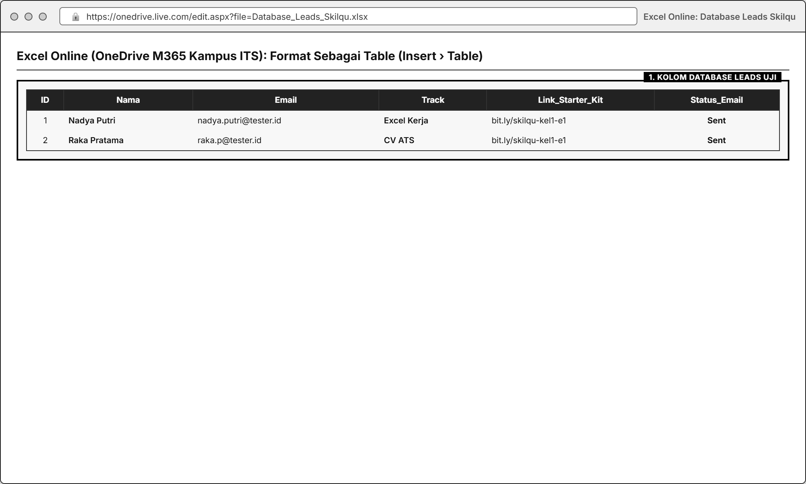
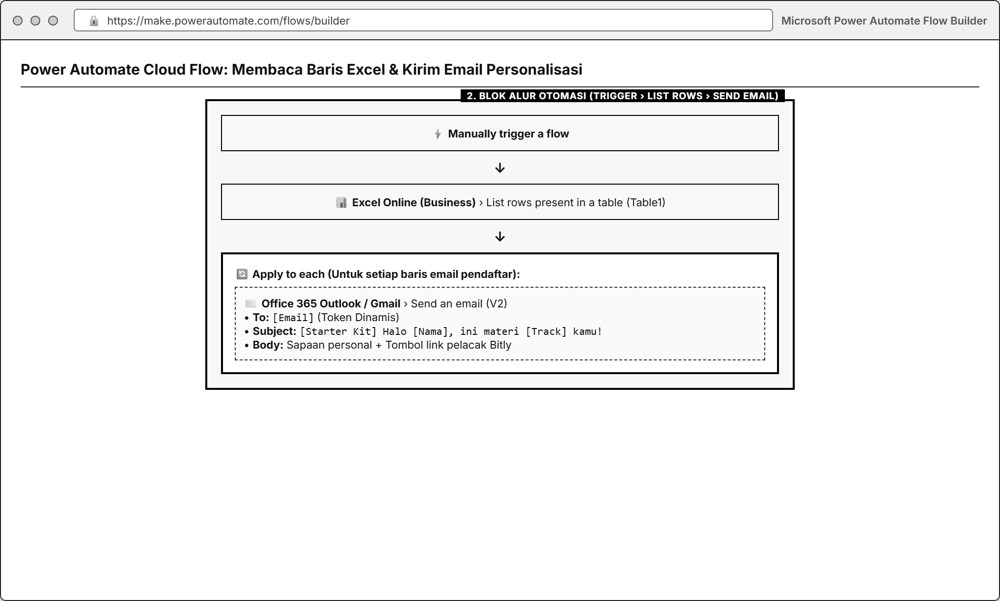
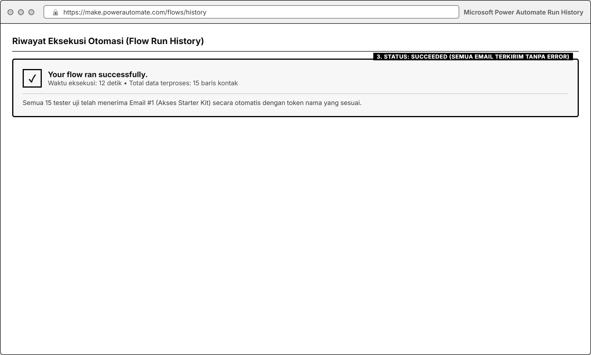
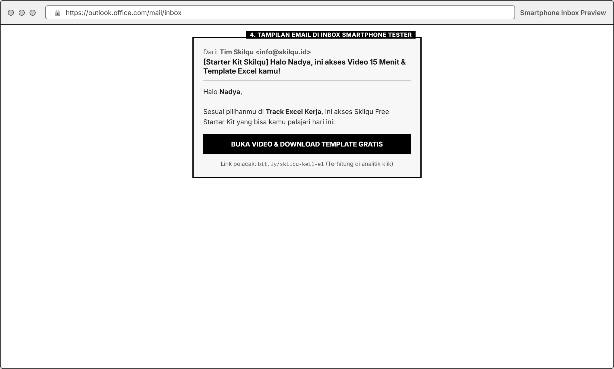

# MODUL 06: RETENTION, ACTIVATION, & SUBSCRIPTION (EMAIL MARKETING AUTOMATION)
**Mata Kuliah**: Pemasaran Digital (Digital Marketing)  
**Program Studi**: Inovasi Digital, Departemen Sistem Informasi, FTEIC  
**Institusi**: Institut Teknologi Sepuluh Nopember (ITS)  
**Minggu Pelaksanaan**: Minggu ke-6 (Dilaporkan & Digabungkan pada Final Report Minggu ke-7)  
**Tools Praktikum**: Microsoft Power Automate (Lisensi M365 Kampus ITS), Excel Online (OneDrive) / Google Sheets, Outlook / Gmail, Bitly (Link Tracking)

---

## 1. Pengantar & Tujuan Praktikum

### A. Mengapa Akuisisi Tanpa Retensi & Aktivasi Akan Merugi?
Mendapatkan pendaftar gratis (*leads*) dari SEO, konten Instagram, dan Meta Ads barulah langkah awal. Pada bisnis berlangganan (*subscription business*) seperti **Skilqu**, pendapatan baru tercipta ketika pengguna gratis:
1. **Teraktivasi (*Activated*)**: Benar-benar membuka dan mempraktikkan materi gratis yang mereka unduh.
2. **Berkonversi (*Converted to Paid*)**: Merasakan manfaatnya lalu memutuskan berlangganan **Skilqu Pass (Rp49.000/bulan)**.
3. **Bertahan (*Retained*)**: Tetap berlangganan di bulan-bulan berikutnya karena terus terbantu.

### B. Kaitan Modul 6 dengan Business Case **Skilqu**
Pada data *baseline* **Skilqu** (Modul 00):
* Dari **100 pendaftar *Free Starter Kit* per bulan**, hanya **30 orang (Activation Rate = 30%)** yang benar-benar membuka materinya, dan hanya **10 orang (Free-to-Paid Conversion = 10%)** yang berlangganan **Skilqu Pass (Rp49.000/bulan)**.
* Penyebab utamanya: setelah mengisi form di *landing page*, pendaftar tidak mendapatkan email pengiriman materi, tidak diingatkan untuk belajar, dan tidak pernah diberi penawaran *upgrade* yang menjawab keraguan mereka.

Pada Modul 6 ini, kelompok akan menutup celah *Bottom of Funnel* tersebut dengan:
1. Merancang **3-Step Email Nurturing Sequence** (*Onboarding $\rightarrow$ Study Reminder $\rightarrow$ Subscription Offer*) yang dipersonalisasi sesuai nama dan *Product Track* pilihan pengguna.
2. Membangun **alur otomatisasi pengiriman email (*Email Automation Flow*)** menggunakan **Microsoft Power Automate** (memanfaatkan lisensi Microsoft 365 kampus ITS) yang terhubung dengan tabel pendaftar dan email (Outlook/Gmail).
3. Menguji pengiriman rangkaian email kepada **minimal 10-15 responden uji (*opt-in testers*)** dan mengukur **Email Click Rate** serta **Subscription Intent / Conversion Rate**.

---

## 2. Landasan Teori: Struktur *3-Step Email Nurturing Sequence*

Jangan langsung menjual paket berbayar di email pertama saat pengguna bahkan belum membuka materi gratisnya! Gunakan alur 3 tahap berikut untuk membimbing persona **Nadya Putri (21 thn)** secara psikologis:

| Urutan Email | Waktu Kirim | Tujuan Utama (*Funnel Stage*) | Isi Pesan Inti untuk Persona Nadya | Tombol CTA & Link Pelacak |
| :--- | :--- | :--- | :--- | :--- |
| **Email #1: Instant Welcome & Starter Kit Delivery** | **Hari ke-0** (Otomatis sesaat setelah daftar) | **Activation** (Mendorong user langsung membuka materi gratis dalam 15 menit pertama) | • Sapaan personal (`Halo [Nama]!`) • Link unduh **Video 15 Menit + Template Latihan** sesuai *Track* pilihan • Panduan 1 langkah mudah agar tidak ditunda | **CTA 1**: *"Buka Video & Download Template Gratis"* (`bit.ly/skilqu-kelX-email1`) |
| **Email #2: Study Reminder & Quick Case Study** | **Hari ke-2** (atau jeda simulasi uji) | **Engagement & Habit Building** (Mengingatkan user yang lupa/sibuk skripsi) | • Mengangkat 1 kesalahan fatal saat tes kerja yang sering tidak disadari • Menanyakan apakah template di Email #1 sudah dicoba • Memberikan 1 *micro-tip* tambahan yang aplikatif | **CTA 2**: *"Lihat Contoh Kasus & Lanjut Latihan"* (`bit.ly/skilqu-kelX-email2`) |
| **Email #3: Subscription Offer & Objection Buster** | **Hari ke-4** (atau tahap akhir simulasi uji) | **Monetization / Paid Conversion** (Mengajak *upgrade* ke **Skilqu Pass Rp49.000/bln**) | • Menghubungkan urgensi jadwal rekrutmen dengan kesiapan penuh • Menawarkan **Skilqu Pass Rp49.000/bulan** (30+ modul lengkap & semua template) • Mematahkan 3 *objection* Nadya: *Seharga 2 es kopi, materi ringkas 15 menit, bisa batal langganan kapan saja* | **CTA 3**: *"Aktifkan Skilqu Pass Rp49.000/Bln Sekarang"* (`bit.ly/skilqu-kelX-email3`) |

---

## 3. Spesifikasi Variabel, Kondisi Kontrol, & KPI Utama Modul 6

| Komponen | Spesifikasi yang Dikunci |
| :--- | :--- |
| **Variabel yang Diamati / Diubah** | • **Segmentasi & Personalisasi**: Penyesuaian `[Nama]` dan `[Pilihan Track]` di dalam isi email • **Subject Line & Preview Text**: Kalimat subjek untuk memancing email dibuka • **Struktur Body Email**: Panjang teks, penempatan manfaat, dan penanganan *objection* • **Desain & Copy Tombol/Tautan CTA** di dalam email |
| **Kondisi Kontrol & Etika Privasi** | • Pengujian pengiriman wajib dilakukan hanya kepada **daftar *opt-in testers*** (minimal 10-15 orang: pendaftar dari *Landing Page* kelompok + anggota uji yang telah memberi izin menerima email simulasi praktikum). **Dilarang mengirim spam ke alamat email acak!** • Setiap email (Email #1, #2, dan #3) wajib menggunakan **tautan pelacak Bitly/UTM yang terpisah** agar klik dari masing-masing email dapat dihitung secara akurat |
| **KPI Utama 1: Email Click-Through Rate (CTR)** | Mengukur proporsi penerima email yang mengklik tautan CTA di dalam email: $$\text{Email CTR (\%)} = \frac{\text{Jumlah Klik Unik pada Link CTA Email}}{\text{Jumlah Email yang Berhasil Terkirim (Delivered)}} \times 100\%$$ *Target Kelas*: • **Email #1 (Activation CTR)**: **$\ge 25{,}0\%$** • **Email #2 (Engagement CTR)**: **$\ge 15{,}0\%$** • **Email #3 (Subscription Offer CTR)**: **$\ge 10{,}0\%$** |
| **KPI Utama 2: Subscription Conversion Rate** | Mengukur proporsi penerima yang mengklik CTA Email #3 lalu mengisi konfirmasi minat berlangganan **Skilqu Pass (Rp49.000/bulan)**: $$\text{Email Conversion Rate (\%)} = \frac{\text{Jumlah Konfirmasi Langganan Skilqu Pass}}{\text{Total Penerima Daftar Lead (Delivered)}} \times 100\%$$ *Target Kelas*: **$\ge 15{,}0\%$** (meningkat dari *baseline* Skilqu 10,0%). |
| **Metrik Pendukung** | • **Delivery Rate** $= \frac{\text{Email Terkirim}}{\text{Total Kontak}} \times 100\%$ • **Open Rate / Read Confirmation** (Proporsi tester yang membuka email) • **Click-to-Conversion Rate** $= \frac{\text{Konfirmasi Langganan}}{\text{Klik pada Email #3}} \times 100\%$ |

---

## 4. Persiapan Tools: Excel Online, Power Automate, & Bitly

1. **Microsoft Power Automate (Gratis dengan Akun Mahasiswa ITS)**:
   * Buka [https://make.powerautomate.com/](https://make.powerautomate.com/) dan login menggunakan akun **Microsoft 365 ITS (`@student.its.ac.id`)**.
   * Konektor yang digunakan adalah **Standard Connectors** (seperti *Excel Online (Business)*, *Microsoft Forms*, *Office 365 Outlook*, atau *Gmail*) yang sudah tercakup dalam lisensi kampus tanpa biaya tambahan.
2. **Excel Online di OneDrive ITS**:
   * Digunakan untuk menyimpan tabel database *Leads* (pendaftar *Skilqu Free Starter Kit*) yang menjadi sumber data otomatisasi.
3. **Tiga Link Pelacak Bitly (Wajib Dibuat Sebelum Membuat Flow)**:
   * **Link CTA Email #1** (`bit.ly/skilqu-kelX-e1`) $\rightarrow$ mengarah ke halaman/folder **Materi Video 15 Menit & Template Gratis Skilqu**.
   * **Link CTA Email #2** (`bit.ly/skilqu-kelX-e2`) $\rightarrow$ mengarah ke halaman **Studi Kasus Lanjutan Skilqu**.
   * **Link CTA Email #3** (`bit.ly/skilqu-kelX-e3`) $\rightarrow$ mengarah ke **Halaman/Form Konfirmasi Upgrade Skilqu Pass Rp49.000/bulan**.

---

## 5. Langkah Praktikum Step-by-Step

### Langkah 1: Menyiapkan Tabel Database Lead di Excel Online (OneDrive)
1. Buka [OneDrive Microsoft 365](https://onedrive.live.com/) dengan akun ITS, lalu buat file **Excel Workbook** baru dengan nama `Database_Leads_Skilqu_KelompokX.xlsx`.
2. Buat kolom pada baris pertama:
   * `ID` | `Nama` | `Email` | `Track` | `Link_Starter_Kit` | `Status_Email`
3. Blok seluruh area header dan baris data, lalu tekan menu **Insert (Sisipkan)** $\rightarrow$ **Table (Tabel)** $\rightarrow$ centang *My table has headers* $\rightarrow$ klik **OK**. *(Penting: Power Automate hanya bisa membaca data Excel jika sudah diformat sebagai **Table**!)*
4. Masukkan daftar minimal **10-15 kontak uji (*opt-in leads*)** yang terdiri dari pendaftar *Landing Page* kalian dan tester mahasiswa yang bersedia mengikuti simulasi.

### Langkah 2: Menulis Naskah *3-Step Email Sequence* Sesuai Tone Skilqu
Susun draf ketiga email dengan memperhatikan prinsip keterbacaan di HP (paragraf pendek 2-3 baris, poin *bullet*, dan 1 tombol/link CTA yang menonjol):

#### Template Struktur Email #1 (Day 0 - Activation / Pengiriman Starter Kit)
* **Subject Line**: `[Starter Kit Skilqu] Halo {{Nama}}, ini akses Video 15 Menit & Template {{Track}} kamu!`
* **Body Copy**:
  > Halo **{{Nama}}**,  
  >  
  > Keren! Kamu udah ambil langkah pertama buat siap-siap tembus kerja/magang tanpa perlu bingung mulai dari mana.  
  >  
  > Sesuai pilihanmu di **Track {{Track}}**, ini akses **Skilqu Free Starter Kit** yang langsung bisa kamu pakai latihan hari ini:  
  > 👉 **[KLIK DI SINI: Buka Video 15 Menit & Download Template {{Track}}](Link_Bitly_Email_1)**  
  >  
  > **Tips biar nggak cuma numpuk di folder download:**  
  > Luangkan **15 menit aja malam ini** buat tonton videonya sambil buka file templatenya. Nggak perlu nunggu luang seharian!  
  >  
  > Semangat persiapannya,  
  > **Tim Skilqu** (*Skill praktis buat tembus kerja pertama*)

#### Template Struktur Email #2 (Day +2 - Engagement & Studi Kasus Singkat)
* **Subject Line**: `{{Nama}}, udah coba template kemarin? Awas terjebak kesalahan tes kerja ini...`
* **Body Copy**:
  > Halo **{{Nama}}**,  
  >  
  > Gimana, udah sempat buka file template **{{Track}}** yang kami kirim kemarin?  
  >  
  > Banyak mahasiswa gagal saat seleksi kerja bukan karena nggak pintar, tapi karena kaget waktu dikasih soal/kondisi yang sedikit berbeda dari contoh di internet. Di studi kasus singkat hari ini, kami membedah **1 kesalahan paling sering dilakukan pelamar saat tahap {{Track}}** dan cara menghindarinya dalam 5 menit:  
  > 👉 **[KLIK DI SINI: Baca Bedah Kasus & Lanjut Latihan](Link_Bitly_Email_2)**  
  >  
  > Yuk cicil latihanmu 15 menit hari ini biar makin pede pas panggilan tes datang!

#### Template Struktur Email #3 (Day +4 - Penawaran Upgrade Skilqu Pass Rp49.000)
* **Subject Line**: `Siap tempur sebelum panggilan kerja? Buka 30+ Modul Skilqu cuma seharga 2 kopi`
* **Body Copy**:
  > Halo **{{Nama}}**,  
  >  
  > Kalau kamu ngerasa terbantu sama *Free Starter Kit* kemarin, bayangkan seberapa siapnya kamu kalau menguasai seluruh materi yang paling sering keluar di seleksi kerja.  
  >  
  > Lewat **Skilqu Pass (Rp49.000/bulan)**, kamu langsung dapat akses penuh ke:  
  > • **30+ Video Praktik Singkat (10-15 menit/materi)** untuk Excel Kerja, CV ATS, & Interview.  
  > • **Seluruh Template Library & Soal Simulasi Asli** siap pakai.  
  > • **Bebas Risiko**: Cuma Rp49.000/bulan (jauh lebih hemat dari bootcamp ratusan ribu) dan **bisa berhenti langganan kapan aja dengan 1 klik** begitu kamu udah keterima kerja!  
  >  
  > Ambil promo akses penuhmu di sini:  
  > 👉 **[AKTIFKAN SKILQU PASS RP49.000/BULAN SEKARANG](Link_Bitly_Email_3)**

### Langkah 3: Membangun Flow Otomatis di Microsoft Power Automate
1. Buka [https://make.powerautomate.com/](https://make.powerautomate.com/), klik menu **+ Create (+ Buat)** di sebelah kiri.
2. Pilih **Instant cloud flow** (*Alur cloud instan* - menggunakan pemicu *Manually trigger a flow* untuk menguji pengiriman batch dari tabel Excel) **ATAU** pilih **Automated cloud flow** (dengan pemicu *When a new response is submitted* pada Microsoft Forms jika form pendaftaran terhubung langsung).
3. **Cara Menyusun Flow Membaca Tabel Excel & Mengirim Email Otomatis**:
   * **Step 1 (Trigger)**: Pilih **Manually trigger a flow**.
   * **Step 2 (Ambil Data Leads)**: Klik **+ New step** $\rightarrow$ cari **Excel Online (Business)** $\rightarrow$ pilih **List rows present in a table**.
     * *Location*: `OneDrive for Business`
     * *Document Library*: `OneDrive`
     * *File*: Pilih `Database_Leads_Skilqu_KelompokX.xlsx`
     * *Table*: Pilih `Table1`
   * **Step 3 (Kirim Email #1 dengan Personalisasi Dinamis)**: Klik **+ New step** $\rightarrow$ cari **Office 365 Outlook** (atau **Gmail**) $\rightarrow$ pilih **Send an email (V2)**.
     * Begitu kamu memasukkan kolom **Email** dari *Dynamic content* pada bagian **To**, Power Automate akan otomatis membungkus langkah tersebut ke dalam blok perulangan **Apply to each** (sehingga setiap baris pendaftar menerima email personalnya masing-masing!).
     * Pada **Subject** dan **Body**, sisipkan token dinamis **`Nama`** dan **`Track`** dari tabel Excel, serta masukkan **Link Pelacak Bitly Email #1**.
   * **Step 4 (Simulasi Jeda & Rangkaian Email #2 dan #3)**:
     * Di dunia nyata, kita menambahkan aksi **Delay (Schedule)** selama `2 Days` sebelum mengirim Email #2 dan `2 Days` lagi sebelum mengirim Email #3.

     * **Untuk Keperluan Praktikum Kelas (Agar Hasil Bisa Diukur dalam Minggu yang Sama)**: Atur aksi **Delay** menjadi jeda simulasi singkat (misal `5 minutes` atau jalankan pengiriman Email #1, #2, dan #3 secara berurutan pada hari ke-1, ke-2, dan ke-3 minggu praktikum).
4. Klik **Save**, lalu klik **Test** $\rightarrow$ **Manually** $\rightarrow$ **Run flow** untuk menjalankan otomatisasi pengiriman email!
5. Ambil *screenshot* struktur **Flow Power Automate** yang berhasil berjalan (*Your flow ran successfully* dengan tanda centang hijau) dan *screenshot* tampilan email yang masuk di kotak masuk (*Inbox*) HP penerima.

### Langkah 4: Mengukur Metrik Funnel Email & Konversi Langganan
Setelah ketiga email terkirim kepada seluruh kontak uji:
1. Cek dashboard **Bitly** untuk melihat jumlah klik pada `Link Email #1`, `Link Email #2`, dan `Link Email #3`.
2. Cek formulir tujuan pada `Link Email #3` (Halaman Konfirmasi Simulasi Langganan **Skilqu Pass Rp49.000/bulan**) untuk melihat berapa tester yang menyelesaikan aksi konversi berlangganan.
3. Rekapitulasi data ke dalam tabel evaluasi funnel email berikut:

| Tahap Email Funnel | Rumus & Denominator | Target Kelas | Hasil Aktual Kelompok |
| :--- | :--- | :--- | :--- |
| **1. Total Leads Delivered** | Email berhasil masuk / Total daftar kontak uji | `100%` (Min. 10-15 kontak) | *(contoh: 15 dari 15 = 100%)* |
| **2. Email #1 CTR (Activation)** | $\text{Klik Link Email #1} \div \text{Delivered} \times 100\%$ | $\ge 25{,}0\%$ | *(contoh: 9 dari 15 = 60,0%)* |
| **3. Email #2 CTR (Engagement)** | $\text{Klik Link Email #2} \div \text{Delivered} \times 100\%$ | $\ge 15{,}0\%$ | *(contoh: 6 dari 15 = 40,0%)* |
| **4. Email #3 CTR (Offer Interest)** | $\text{Klik Link Email #3} \div \text{Delivered} \times 100\%$ | $\ge 10{,}0\%$ | *(contoh: 4 dari 15 = 26,7%)* |
| **5. KPI Utama: Paid Conversion Rate** | $\text{Konfirmasi Skilqu Pass} \div \text{Delivered} \times 100\%$ | $\ge 15{,}0\%$ (Baseline 10%) | *(contoh: 3 dari 15 = 20,0%)* |

---

## 6. Tugas Kelompok Minggu 6

1. **Rancang *3-Step Email Nurturing Sequence* Lengkap**:
   * Tampilkan *Subject Line*, *Body Copy*, dan strategi psikologis untuk **Email #1 (Activation)**, **Email #2 (Engagement)**, dan **Email #3 (Subscription Offer Rp49.000/bln)**.
2. **Bangun & Jalankan Otomatisasi di Microsoft Power Automate**:
   * Tampilkan *screenshot* tabel `Database_Leads` di Excel Online, diagram alur **Power Automate** beserta konfigurasi token dinamis (`Nama`, `Track`), bukti *Flow Run Succeeded*, dan tampilan ketiga email saat dibuka di layar HP.
3. **Analisis Funnel Email & Dampak pada Unit Economics Skilqu**:
   * Hitung **Email CTR (#1, #2, #3)** dan **Subscription Conversion Rate** lengkap dengan denominatornya.
   * Hitung kembali **Simulated CAC & ROAS** dari Modul 5 jika menggunakan rasio konversi langganan dari eksperimen email kalian di Modul 6!
   * Hasil Modul 6 ini akan langsung dimasukkan ke dalam **Final Report A-Z (Minggu ke-7)**.

---

## 7. Rubrik Penilaian Modul 6 (100 Poin)

| Komponen Penilaian | Bobot | Indikator Penilaian Utama |
| :--- | :--- | :--- |
| **1. Strategi & Copywriting 3-Step Email Sequence** | **30%** | Kejelasan alur psikologis dari *Activation* (Email #1) ke *Engagement* (Email #2) hingga *Subscription Pitch & Objection Handling* (Email #3) sesuai *Tone* Skilqu. |
| **2. Keberhasilan Implementasi Flow Power Automate** | **30%** | Bukti *screenshot* tabel Excel, struktur flow Power Automate dengan personalisasi dinamis (`Nama`, `Track`), dan bukti email terkirim dengan rapi di HP. |
| **3. Pelacakan Klik & Akurasi Perhitungan KPI Email** | **20%** | Pemisahan 3 link pelacak untuk masing-masing email, perhitungan *Email CTR* dan *Conversion Rate* lengkap dengan denominator (min. 10-15 kontak uji). |
| **4. Integrasi dengan Perhitungan CAC & Retensi Bisnis** | **20%** | Kemampuan menghubungkan hasil konversi email dengan efisiensi biaya akuisisi (*CAC/ROAS*) dan strategi menekan *churn* pelanggan di bulan ke-2. |
