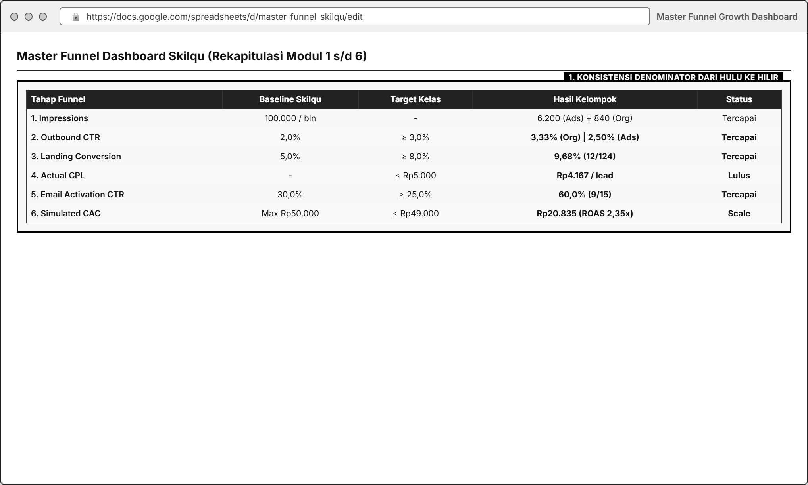
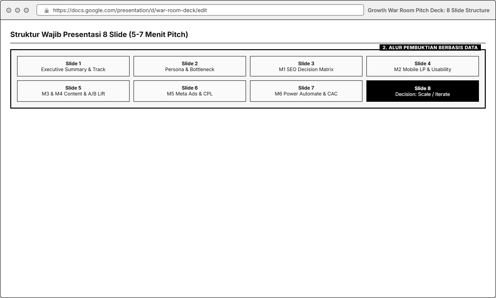

# MODUL 07: FINAL REPORT A-Z & GROWTH WAR ROOM PITCH
**Mata Kuliah**: Pemasaran Digital (Digital Marketing)  
**Program Studi**: Inovasi Digital, Departemen Sistem Informasi, FTEIC  
**Institusi**: Institut Teknologi Sepuluh Nopember (ITS)  
**Minggu Pelaksanaan**: Minggu ke-7 (Presentasi Akhir & Pengumpulan Portofolio A-Z)  
**Tools Praktikum**: Google Slides / Canva Presentation, Google Sheets / Looker Studio (Funnel Dashboard)

---

## 1. Pengantar & Tujuan Pertemuan Terakhir

Minggu ke-7 adalah puncak dari rangkaian **Digital Growth Lab: Skilqu**. Seluruh pekerjaan yang telah dilakukan oleh kelompok dari **Minggu ke-1 hingga Minggu ke-6** tidak lagi dilihat sebagai enam tugas terpisah, melainkan dirangkai menjadi **satu narasi pertumbuhan bisnis (*End-to-End Growth Story*) berbasis bukti data**.

Dalam sesi **Growth War Room**, setiap kelompok berperan sebagai **Growth Squad Skilqu** yang mempresentasikan hasil eksperimen 6 minggu di hadapan manajemen/dosen selama **5-7 menit**, diikuti tanya jawab singkat.

> **Prinsip Utama Penilaian Akhir**:  
> Nilai tertinggi **tidak** otomatis diberikan kepada kelompok dengan angka klik atau konversi terbesar, melainkan kepada kelompok yang menunjukkan **kualitas *learning loop* paling tajam** (*Evidence $\rightarrow$ Hypothesis $\rightarrow$ Execution $\rightarrow$ Measurement $\rightarrow$ Learning $\rightarrow$ Keputusan Scale / Iterate / Stop*).

---

## 2. Tabel Rekapitulasi End-to-End Funnel Skilqu (Wajib Ada di Laporan)

Setiap kelompok wajib menyatukan data aktual dan proyeksi dari Modul 1-6 ke dalam **Master Funnel Dashboard** berikut:

| Tahap Funnel | Modul Sumber | KPI Utama yang Diukur | Baseline Awal Skilqu | Target Kelas | Hasil Aktual Kelompok (Beserta Denominator!) | Status & Bottleneck Analysis |
| :--- | :--- | :--- | :--- | :--- | :--- | :--- |
| **1. Search & Discovery** | **Modul 1: SEO** | *Keyword Priority Score* & *On-Page SEO Score* | Belum teroptimasi | Priority $\ge 4{,}0$ \| On-Page $\ge 90\%$ | *(Contoh: Skor 4,35/5,00 & Checklist 10/10 = 100%)* | Keyword utama berhasil dikunci untuk halaman |
| **2. Landing UX & Clarity** | **Modul 2: Usability** | *Task Completion Rate* & *CTA Findability* | - | Task Completion $\ge 80\%$ (Min. 10 tester) | *(Contoh: 11 dari 12 tester berhasil = 91,7% \| Clarity 4,4/5)* | Tombol CTA di layar HP sudah jelas |
| **3. Organic Content** | **Modul 3: Content** | *Outbound CTR* & *Save Rate* | CTR `2,0%` | Outbound CTR $\ge 3{,}0\%$ | *(Contoh: 24 klik dari 750 impressions = 3,20%)* | Hook masalah tes kerja efektif menarik klik |
| **4. Controlled Experiment** | **Modul 4: A/B Test** | *Relative A/B Lift (%)* pada KPI Utama | - | Eksperimen 1 variabel valid | *(Contoh: Varian B menang dengan Lift +64,2% pada CTR)* | Varian B dipilih untuk dibawa ke Meta Ads |
| **5. Paid Acquisition** | **Modul 5: Meta Ads** | *Actual CPL* (Biaya/Pendaftar Gratis) & *Link CTR* | Batas CPL $\le$ `Rp5.000` | CPL $\le$ `Rp5.000` | *(Contoh: Spend Rp50.000 $\div$ 12 pendaftar = Rp4.167/lead)* | Efisien di bawah batas atas CPL |
| **6. Landing Conversion** | **Modul 2, 4, & 5** | *Landing Page Conversion Rate* (Gabungan/Per Kanal) | LP Conv. `5,0%` | LP Conv. $\ge 8{,}0\%$ | *(Contoh: 18 pendaftar dari 205 total visitors = 8,78%)* | Melampaui baseline 5,0% |
| **7. Activation & Subscription** | **Modul 6: Email** | *Email #1 CTR* & *Paid Subscription Conversion Rate* | Activation `30%` \| Paid Conv. `10%` | Email #1 CTR $\ge 25\%$ \| Paid Conv. $\ge 15\%$ | *(Contoh: Email #1 CTR 9/15 = 60% \| Paid Conv. 3/15 = 20%)* | Otomasi Power Automate meningkatkan aktivasi |
| **8. Unit Economics Akhir** | **Modul 5 & 6** | *Simulated CAC* & *ROAS* (**Skilqu Pass Rp49.000**) | Batas CAC $\le$ `Rp50.000` | CAC $\le$ `Rp49.000` (ROAS $\ge 1{,}0\text{x}$) | *(Contoh: CPL Rp4.167 $\div$ 20% Paid Conv = CAC Rp20.835 \| ROAS Bln-1 = 2,35x)* | Model akuisisi & email siap di-*scale* |

---

## 3. Struktur Wajib Presentasi 8-Slide (*Growth War Room Deck*)

Setiap kelompok wajib menyusun slide presentasi yang padat, visual, dan berbasis data dengan struktur **8 Slide** berikut:

| Slide | Judul Slide | Isi Wajib yang Harus Ditampilkan |
| :--- | :--- | :--- |
| **Slide 1** | **Executive Summary: Skilqu Track, Target, & Headline Result** | Nama Squad, anggota & peran, pilihan *Product Track* (Excel/CV/Interview), ringkasan masalah utama, dan 3 angka capaian terpenting kelompok. |
| **Slide 2** | **Customer Persona Diagnosis & Buyer Journey Bottleneck** | Pemetaan **Nadya Putri (21 thn)**, bukti *verbatim* yang diangkat, dan alasan mengapa kelompok memfokuskan strategi pada *pain point/trigger* tersebut. |
| **Slide 3** | **Modul 1: SEO Research & On-Page Blueprint** | Tabel *Top 3-5 Priority Keywords* (beserta alasan tidak sekadar memilih volume terbesar) dan tampilan *On-Page SEO Spec* halaman Skilqu. |
| **Slide 4** | **Modul 2: Mobile-First Landing Page & Usability Findings** | Screenshot *Landing Page* di layar HP, skor *Usability Testing* (Task Completion, Clarity, Findability, Trust dari $\ge 10$ tester), serta perbaikan UX yang dilakukan. |
| **Slide 5** | **Modul 3 & 4: Content Strategy & A/B Experiment Result** | Perbandingan berdampingan **Versi A vs Versi B**, variabel yang dikontrol, tabel metrik ber-denominator, perhitungan **A/B Lift (%)**, dan evaluasi validitas sampel. |
| **Slide 6** | **Modul 5: Meta Ads Campaign, Funnel Diagnostics, & CPL** | Konfigurasi *Audience & Placement*, tabel *Impressions $\rightarrow$ Link Clicks $\rightarrow$ Landing Visits $\rightarrow$ Leads*, perhitungan **Actual CPL**, dan diagnosis kebocoran iklan. |
| **Slide 7** | **Modul 6: Email Automation Flow & Unit Economics (CAC & ROAS)** | Screenshot alur **Microsoft Power Automate**, metrik *3-Step Email Sequence* (*Email #1, #2, #3*), serta perhitungan akhir **Simulated CAC vs Harga Langganan Rp49.000 (ROAS)**. |
| **Slide 8** | **Growth War Room Decision: Scale, Iterate, or Stop?** | Matriks keputusan akhir berdasarkan bukti data: apa yang **berhasil (*Scale*)**, apa yang **perlu diperbaiki (*Iterate*)**, dan apa yang **harus dihentikan (*Stop*)** beserta keterbatasan data eksperimen. |

---

## 4. Matriks Keputusan Akhir: *Scale, Iterate, or Stop*

Pada Slide 8 dan bagian kesimpulan laporan tertulis, kelompok wajib mengambil keputusan strategis menggunakan panduan berikut:

1. **SCALE (Perbesar Anggaran / Eksekusi)**  
   Dipilih jika **Actual CPL $\le$ Rp5.000**, **Landing Conversion $\ge$ 8,0%**, dan **Simulated CAC $\le$ Rp49.000**. Jelaskan bagaimana kelompok akan mengalokasikan anggaran simulasi **Rp100 Juta** untuk mencapai **1.000 pelanggan berbayar Skilqu Pass**.
2. **ITERATE (Perbaiki Bottleneck Spesifik Sebelum Scale)**  
   Dipilih jika salah satu tahap funnel sudah bagus namun tahap lainnya masih bocor (contoh: *CTR iklan tinggi 3,8%, tetapi Landing Page Conversion masih 3,5%*). Jelaskan **1 eksperimen lanjutan** yang harus dilakukan sebelum berani menambah anggaran iklan.
3. **STOP / PIVOT ANGLE (Hentikan Pendekatan yang Terbukti Gagal)**  
   Sebutkan secara jujur *angle* konten, kata kunci, atau segmen target yang terbukti tidak efektif selama 6 minggu agar perusahaan tidak membuang anggaran di masa depan.

---

## 5. Rubrik Penilaian Akhir Keseluruhan Praktikum (100 Poin)

| Komponen Penilaian | Bobot | Indikator Penilaian Utama |
| :--- | :--- | :--- |
| **1. Customer Insight & Journey Diagnosis (Modul 00)** | **10 Poin** | Ketajaman memetakan masalah, *trigger*, dan *objection* persona Nadya berbasis bukti. |
| **2. SEO & Keyword Decision Quality (Modul 1)** | **10 Poin** | Kualitas matriks keputusan keyword (*Priority Score*) dan kelengkapan *On-Page SEO Blueprint*. |
| **3. Mobile-First Landing Page & Usability Testing (Modul 2)** | **20 Poin** | Kejelasan halaman di layar HP, kepatuhan protokol $\ge 10$ tester, dan kualitas temuan *usability*. |
| **4. Content Strategy & A/B Experimentation (Modul 3 & 4)** | **20 Poin** | Kekuatan *Hook-Retain-Reward-CTA*, disiplin isolasi 1 variabel pada A/B test, dan akurasi perhitungan *Lift*. |
| **5. Paid Acquisition Meta Ads & Data Integrity (Modul 5)** | **15 Poin** | Ketepatan struktur *Campaign-Ad Set-Ad*, pelacakan UTM/link terpisah, serta perhitungan *CPL, CAC, & ROAS*. |
| **6. Email Retention Automation & Subscription Flow (Modul 6)** | **15 Poin** | Kualitas *3-Step Email Sequence*, keberhasilan otomasi di **Power Automate**, dan metrik klik/konversi email. |
| **7. Final Synthesis & Growth War Room Pitch (Modul 7)** | **10 Poin** | Keutuhan cerita dari hulu ke hilir, konsistensi denominator di seluruh tabel, dan ketajaman keputusan *Scale/Iterate/Stop*. |
| **TOTAL SKOR AKHIR** | **100 Poin** | - |

---

## 6. Lampiran Wajib: Log Kontribusi & Refleksi Individu (*Anti Free-Rider*)

Untuk memastikan keadilan penilaian di dalam kelompok berisi 5 orang, setiap laporan akhir wajib melampirkan **Tabel Log Kontribusi Kelompok** dan **1 Paragraf Refleksi Individu** per anggota:

| No | Nama & NRP Mahasiswa | Peran Utama di Growth Squad | Kontribusi Spesifik dari Modul 1 s/d Modul 6 | Persentase Kontribusi (Disepakati Bersama) |
| :--- | :--- | :--- | :--- | :--- |
| 1 | *[Nama Anggota 1]* | Project & Analytics Lead | Mengelola Master Funnel Sheet, setup UTM/Bitly, analisis A/B Lift & CAC/ROAS | `20%` |
| 2 | *[Nama Anggota 2]* | SEO & Copywriting Specialist | Riset Ahrefs/Semrush Modul 1, copywriting Landing Page & 3 Email Sequence | `20%` |
| 3 | *[Nama Anggota 3]* | Landing Page & UX Lead | Membangun halaman Canva/Vibe Code Modul 2, mengoordinasi 10+ tester Usability | `20%` |
| 4 | *[Nama Anggota 4]* | Content & Creative Lead | Mendesain aset Carousel/Reels Modul 3 & varian visual A/B Test Modul 4 | `20%` |
| 5 | *[Nama Anggota 5]* | Paid Ads & Automation Lead | Setup Meta Ads Manager Modul 5 & membangun flow Power Automate Modul 6 | `20%` |

### Pertanyaan Refleksi Singkat Individu (Maksimal 150 Kata per Anggota):
1. Bagian eksperimen mana dari proyek **Skilqu** yang paling mengubah cara pandangmu tentang pemasaran digital?
2. Jika kelompokmu diberi waktu 1 minggu tambahan dan anggaran riil Rp1.000.000, satu perubahan spesifik apa yang akan kamu usulkan berdasarkan data yang sudah terkumpul?

### Format Pengumpulan Final Minggu ke-7
* **Laporan Lengkap A-Z (PDF)**: `Kelompok X_Final Report A-to-Z_Skilqu.pdf`
* **Slide Presentasi 8-Slide (PDF/PPTX)**: `Kelompok X_Growth War Room Deck_Skilqu.pdf`
* **Master Funnel & Raw Data (Google Sheets / Excel)**: Tautan aktif dengan akses *Viewer/Commenter* untuk dosen dan asisten.
